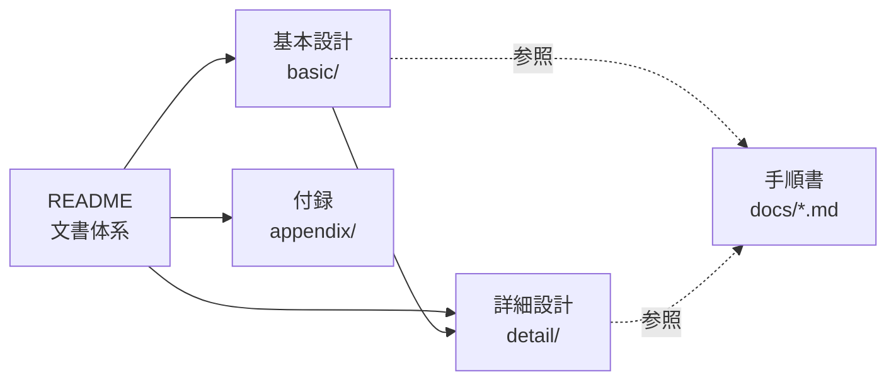

# TCSecurityKeyEmulator 設計書

| 項目 | 内容 |
|---|---|
| 文書番号 | TCSKE-DS-00 |
| 版数 | 1.7 |
| 作成日 | 2026-11-02 |
| 対象 | セキュリティキーエミュレータ (TCSecurityKeyEmulator) 0.1.0 (versionCode 1) |

## 名称

| 区分 | 名称 |
|---|---|
| アプリ名 (ランチャー・サイドバー上部などの表示名) | 日本語「セキュリティキーエミュレータ」、英語「Security Key Emulator」 |
| プロジェクト名・リポジトリ名 | `TCSecurityKeyEmulator` (https://github.com/tecogonaz0439/TCSecurityKeyEmulator) |
| 旧名 (2026-11-03 まで) | `TCAndroidKey` |
| applicationId・パッケージ名 | `net.tecogonaz.tcsecuritykeyemulator` (旧 `net.tecogonaz.tcandroidkey`)。旧版とは別アプリのため上書き更新できず、鍵も引き継げない (旧版はアンインストールし、鍵は再登録する。BD-07 §5) |
| 変更しない識別子 | AAGUID (`523283ca-3c2c-48b5-8bff-a722f900e190`、認証器のモデルとして同一のため)、クレデンシャル鍵のエイリアス接頭辞 `fido_cred_` |

設計書では、システム・プロジェクトを指す場合に `TCSecurityKeyEmulator`、画面の表示を指す場合にアプリ名を用いる。

## 本アプリの位置付け (重要)

> **TCSecurityKeyEmulator は、FIDO / FIDO2 (WebAuthn) を使用した Web アプリケーションの開発・テスト用ツールである。**
> **YubiKey などの物理セキュリティキーの代替としては使用しない。**
>
> - 本番サービスのアカウント、業務システムの本番認証、重要なアカウントの 2 要素認証には登録しない。
> - FIDO Alliance の認定 (FIDO Certified) を受けた認証器ではなく、AAGUID もメタデータサービス (MDS) に登録されていない。
> - アプリのアンインストール、端末の初期化、画面ロックの変更などで鍵が失われることがあり、復旧手段はない。
>
> 詳細は [基本設計 01 システム概要](basic/01_system-overview.md) の「利用目的と前提」を参照。

## 文書体系

### 基本設計 (`basic/`)

「何を・どのような方針で作るか」を定める。

| No. | 文書 | 内容 |
|---|---|---|
| BD-01 | [システム概要](basic/01_system-overview.md) | 利用目的と前提、利用シーン、スコープ、システム構成 |
| BD-02 | [要件定義](basic/02_requirements.md) | 前提条件 (PRE)、機能要件 (FR)、非機能要件 (NFR)、セキュリティ要件 (SEC) |
| BD-03 | [アーキテクチャ](basic/03_architecture.md) | モジュール・レイヤ構成、処理方式、技術スタック |
| BD-04 | [外部インターフェース](basic/04_external-interface.md) | NFC / Bluetooth / USB、対応クライアントと互換性 |
| BD-05 | [セキュリティ方針](basic/05_security.md) | 保護資産、脅威と対策、認可モデル |
| BD-06 | [画面設計 (概要)](basic/06_ui.md) | 画面一覧、画面遷移、レイアウト方針、流用部品 |
| BD-07 | [開発・ビルド・配布](basic/07_build-release.md) | 開発環境、署名、バージョン、配布 |
| BD-08 | [テスト計画](basic/08_test-plan.md) | テスト方針、テストレベル、試験環境 |
| BD-09 | [運用](basic/09_operations.md) | 導入、日常利用、障害時対応、利用終了 |

### 詳細設計 (`detail/`)

「どのように実装するか」を定める。実装 (コミット時点のソースコード) と一致させる。

| No. | 文書 | 内容 |
|---|---|---|
| DD-01 | [CTAP2 プロトコル](detail/01_ctap2.md) | 各コマンドの入出力・検証順序・エラー、authenticatorData |
| DD-02 | [NFC トランスポート](detail/02_nfc.md) | APDU 仕様、チェイニング、HCE サービス |
| DD-03 | [Bluetooth HID トランスポート](detail/03_bluetooth-hid.md) | CTAPHID 仕様、HID Device プロファイル |
| DD-04 | [モジュール・クラス設計](detail/04_modules.md) | パッケージ・クラスの責務と公開 API |
| DD-05 | [状態遷移](detail/05_state-machines.md) | 認証受付セッション、NFC、Bluetooth、本人確認 |
| DD-06 | [データ設計](detail/06_data.md) | クレデンシャル、暗号化ファイル、設定、ログ |
| DD-07 | [鍵管理](detail/07_key-management.md) | Keystore 鍵属性、鍵のライフサイクル、署名処理 |
| DD-08 | [画面詳細](detail/08_ui-detail.md) | 画面ごとの表示項目・状態別表示・操作 |
| DD-09 | [エラー処理・ログ](detail/09_error-logging.md) | エラー分類と対応表、ログ仕様 |
| DD-10 | [テスト仕様](detail/10_test-cases.md) | 単体テスト一覧、実機試験項目、要件との対応 |

### 付録 (`appendix/`)

| No. | 文書 |
|---|---|
| AP-A | [用語集](appendix/A_glossary.md) |
| AP-B | [参照仕様](appendix/B_references.md) |
| AP-C | [既知の制約と今後の課題](appendix/C_roadmap.md) |

### 手順書 (`docs/` 直下)

| 文書 | 内容 |
|---|---|
| [CLOUD-BUILD.md](../CLOUD-BUILD.md) | クラウド (Claude Code on the web) でのビルド環境 |
| [LOCAL-BUILD-macOS.md](../LOCAL-BUILD-macOS.md) | macOS + Android Studio でのローカルビルド |
| [TESTING.md](../TESTING.md) | 実機での動作確認手順 |

## 記述ルール

- 形式は Markdown、図は Mermaid で記述する。
- 要件 ID: `PRE-nn` (前提)、`FR-nn` (機能)、`NFR-nn` (非機能)、`SEC-nn` (セキュリティ)。
  設計・テスト項目からこの ID を参照し、追跡性を確保する。
- 識別子・プロトコル用語は英語表記のまま記載する。
- 未実装の事項は [AP-C](appendix/C_roadmap.md) に記載し、本体には「現状の設計」のみを記載する。

## 改訂履歴

| 版数 | 日付 | 内容 |
|---|---|---|
| 1.0 | 2026-11-02 | 初版 (旧 `docs/DESIGN.md` の内容を移行・拡充) |
| 1.1 | 2026-11-02 | 外部レビュー (ChatGPT Pro、対象 `ecd6e49`) の指摘 29 件の精査と対応を反映。改訂した文書: BD-03〜05、DD-01〜10、AP-C。指摘ごとの判定と対応は [`review/FIX_PLAN.md`](../../review/FIX_PLAN.md) |
| 1.2 | 2026-11-02 | 言語設定 (FR-19) と注意書きの表示 (FR-20) を追加。改訂した文書: BD-02、BD-06、DD-06、DD-08、DD-10 |
| 1.3 | 2026-11-03 | 名称変更: アプリ名を「セキュリティキーエミュレータ / Security Key Emulator」、プロジェクト名・リポジトリ名を `TCSecurityKeyEmulator`、applicationId・パッケージ名を `net.tecogonaz.tcsecuritykeyemulator` に変更 (旧 `TCAndroidKey` / `net.tecogonaz.tcandroidkey`)。文書番号の接頭辞を `TCSKE-` に変更。全文書の名称・URL を更新。アプリのアイコン (BD-06 §6)、旧版からの移行 (BD-09 §4)、app の単体テスト (DD-10 §1.10) を追記 |
| 1.4 | 2026-11-05 | PIN/UV Auth Protocol 1 / 2 (DD-01 §10) と hmac-secret 拡張・ClientPIN の getKeyAgreement (FR-21、DD-01 §11) を追加。改訂した文書: BD-02、BD-04、BD-05、DD-01、DD-04、DD-06〜08、DD-10、AP-C |
| 1.5 | 2026-11-05 | CTAP 2.1 (FR-22〜24: 内蔵 UV による pinUvAuthToken、credProtect、authenticatorCredentialManagement。DD-01 §12) を追加し、`FIDO_2_0` と `FIDO_2_1` を共存させる。改訂した文書: BD-01、BD-02、BD-04、BD-05、DD-01、DD-02、DD-04〜08、DD-10、AP-A、AP-C |
| 1.6 | 2026-11-05 | clientPIN (FR-25: PIN の設定・変更・照合・PIN によるトークン、FR-26: アプリでの PIN の表示と消去。DD-01 §13) を追加。改訂した文書: BD-02、BD-04〜06、DD-01、DD-04〜09、DD-10、AP-A、AP-C |
| 1.7 | 2026-11-05 | クレデンシャルのタイトル (FR-27: SC-02 の 1 行目に編集可能なタイトル。既定は rp.name、なければ RP ID。上書き登録で引き継ぐ) を追加。改訂した文書: BD-02、DD-01、DD-04、DD-06、DD-08、DD-10 |
