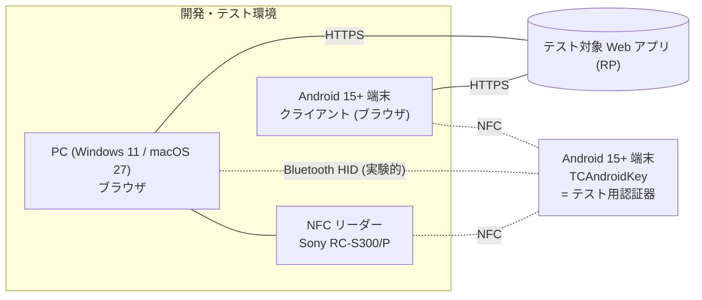
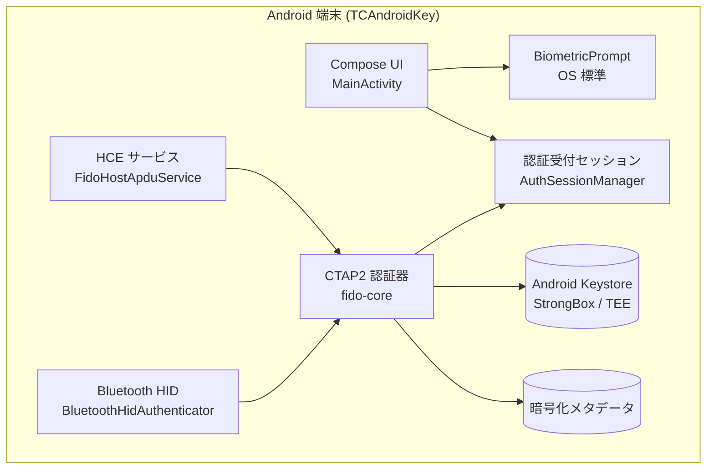
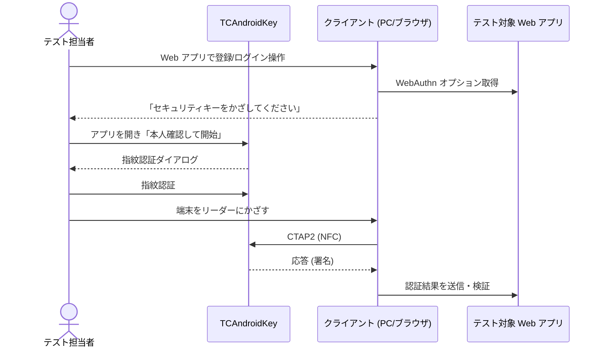

# BD-01 システム概要

| 項目 | 内容 |
|---|---|
| 文書番号 | TCAK-BD-01 |
| 版数 | 1.0 |
| 作成日 | 2026-11-02 |
| 関連文書 | BD-02 要件定義、BD-04 外部インターフェース、BD-05 セキュリティ方針 |

## 1. 目的

FIDO / FIDO2 (WebAuthn) に対応した Web アプリケーションを開発・テストする際に、
**Android 端末を FIDO2 (CTAP2) のローミング認証器 (セキュリティキー) として使えるようにする**。

開発者・テスト担当者が、物理セキュリティキーを人数分・台数分用意しなくても、手元の Android 端末で
次のような WebAuthn の動作 (登録・認証・パスキー・エラー系) を確認できることを目的とする。

- RP (Relying Party) の登録 (`navigator.credentials.create`) / 認証 (`navigator.credentials.get`) 処理
- discoverable credential (パスキー) と non-discoverable credential の両方の挙動
- 同一 RP 複数アカウント時のアカウント選択、excludeCredentials による重複登録の拒否
- 署名カウンタ、UV (ユーザー検証) フラグ、アテステーション形式 (`none` / `packed` 自己アテステーション) の扱い
- 認証器を削除・リセットした後の RP 側の振る舞い

## 2. 利用目的と前提 (重要)

| ID | 前提 |
|---|---|
| PRE-01 | **本アプリは FIDO / FIDO2 を使用した Web アプリケーションのテスト用として利用する。** |
| PRE-02 | **YubiKey などの物理セキュリティキーの代替としては使用しない。** 本番サービス・業務システムの本番認証・重要アカウントの多要素認証には登録しない。 |
| PRE-03 | 本アプリは FIDO Alliance の認定を受けた認証器ではない。AAGUID (`523283ca-3c2c-48b5-8bff-a722f900e190`) は FIDO メタデータサービス (MDS) に登録されておらず、認証器の真正性をアテステーションで証明しない。 |
| PRE-04 | 鍵は端末内にのみ存在し、バックアップ・移行・復旧の手段はない。アプリのアンインストール、端末初期化、画面ロックの変更等で失われうる。テスト用アカウントでの利用を前提とし、鍵の喪失を許容する。 |
| PRE-05 | 利用者は Web アプリケーションの開発者・テスト担当者である (一般利用者への配布は想定しない)。 |

### 2.1 物理キーの代替としない理由

- **保護レベルの違い**: 物理キーは専用のセキュアエレメントで鍵と認証処理を閉じて行うが、本アプリでは
  CTAP 処理 (認可判定・カウンタ管理等) が Android アプリのプロセス上で動作する。鍵自体は Android Keystore で保護するが、
  端末 OS・アプリの脆弱性の影響を受ける範囲が物理キーより広い。
- **認定・検証の欠如**: FIDO 認定試験・第三者評価を受けていない。
- **可用性**: バックアップ不可、アンインストールで消失、端末の故障・紛失で即喪失する。
- **仕様の対応範囲**: CTAP 2.0 のサブセット (clientPIN・U2F・拡張機能は非対応) であり、RP によっては利用できない (AP-C)。

これらは「テスト用ツール」としては許容できるが、本番アカウントを保護する認証器としては不十分であるため、PRE-02 を設ける。

## 3. 利用シーン

| シーン | 内容 |
|---|---|
| S-1 | PC のブラウザで開発中の Web アプリにアクセスし、PC/SC リーダーに TCAndroidKey 端末をかざして登録・認証を試す |
| S-2 | 別の Android 端末のブラウザから、端末同士を重ねて (NFC) 登録・認証を試す |
| S-3 | PC から CTAP レベルの試験スクリプト (python-fido2) を実行し、認証器としての応答を確認する |
| S-4 | (実験的) PC と Bluetooth でペアリングし、HID セキュリティキーとして試す |

## 4. スコープ

| 区分 | 内容 |
|---|---|
| 対象 | CTAP 2.0 認証器 (ES256)、NFC (HCE)、Bluetooth HID (実験的)、Android Keystore による鍵保管、クレデンシャルの一覧・個別削除・全削除、本人確認 (BiometricPrompt) による認可、日本語・英語 UI |
| 対象外 | USB 接続 (技術的に不可)、clientPIN / CTAP 2.1 / U2F (CTAP1)、WebAuthn 拡張 (hmac-secret, credProtect, largeBlob 等)、鍵のバックアップ・同期、エンタープライズアテステーション、Google Play での配布 |

## 5. システム構成

### 5.1 動作環境

| 区分 | 環境 |
|---|---|
| 認証器端末 | Android 15 (API 35) 以上、NFC カードエミュレーション (HCE) 対応、画面ロック設定済み。Class 3 生体認証推奨。Google Play 開発者サービスは不要 |
| クライアント (試験環境) | Windows 11 + Sony RC-S300/P、macOS 27 + Sony RC-S300/P、Android 15+ (NFC 搭載・別端末) |
| 開発環境 | クラウド (Claude Code on the web) で APK 作成、ローカル macOS 27 + Android Studio でビルド・デバッグ |

## 6. 基本的な利用の流れ

