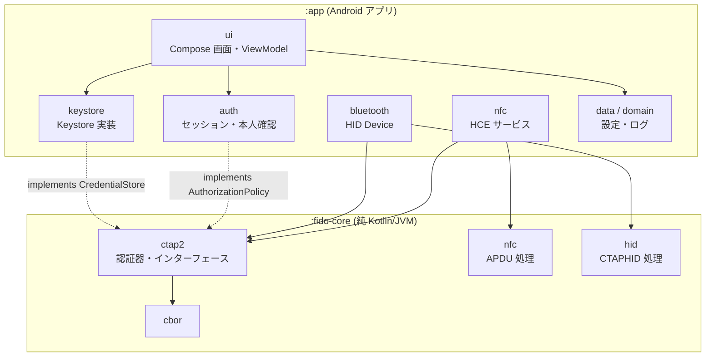
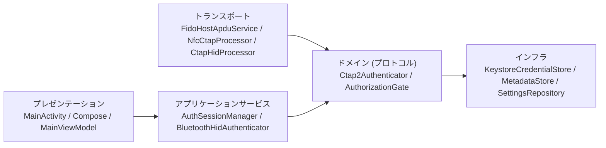

# BD-03 アーキテクチャ

| 項目 | 内容 |
|---|---|
| 文書番号 | TCSKE-BD-03 |
| 版数 | 1.1 |
| 作成日 | 2026-11-02 |
| 改訂 | 1.1 (2026-11-02): 外部レビュー対応 (認可判定を `fido.session.AuthorizationGate` に集約)。`review/FIX_PLAN.md` |
| 関連文書 | DD-04 モジュール・クラス設計、DD-05 状態遷移 |

## 1. 設計方針

| 方針 | 内容 | 関連要件 |
|---|---|---|
| プロトコル層の分離 | CBOR・CTAP2・APDU・CTAPHID を Android 非依存の `fido-core` モジュールに置き、JVM 単体テストで検証する | NFR-11 |
| トランスポート非依存 | CTAP2 処理 (`Ctap2Authenticator`) はトランスポート (NFC / HID) を知らない。各トランスポートはフレーミングのみを担当する | FR-01, FR-02 |
| 依存の抽象化 | 鍵保管 (`CredentialStore`) と認可判定 (`AuthorizationPolicy`) をインターフェースとし、Android 実装を `app` に置く | NFR-04, FR-11 |
| 最小依存 | AndroidX 以外のライブラリを使わない (DI フレームワーク・シリアライザ・GMS 不使用)。JSON は Android 標準の `org.json` | NFR-03 |
| UI 流用 | TCSameuraDamMonitor-android のテーマ・ドロワー・設定部品を流用する | NFR-08 |

## 2. モジュール構成

| モジュール | パッケージ | 責務 |
|---|---|---|
| `:fido-core` | `fido.cbor` | CTAP2 canonical CBOR |
| | `fido.ctap2` | CTAP2 コマンド処理、`CredentialStore` / `AuthorizationPolicy` インターフェース、定数 |
| | `fido.nfc` | ISO 7816-4 APDU (SELECT / NFCCTAP_MSG / チェイニング) |
| | `fido.hid` | CTAPHID フレーミング |
| | `fido.session` | 全トランスポート共有の認可ゲート (`AuthorizationGate`: 前面・受付・ワンタイム予約・失効) |
| `:app` | `keystore` | Android Keystore による鍵生成・署名・削除、暗号化メタデータ |
| | `auth` | 認証受付セッション、BiometricPrompt |
| | `nfc` | `HostApduService` 実装 |
| | `bluetooth` | `BluetoothHidDevice` 実装 (実験的) |
| | `data` / `domain` | 設定 (SharedPreferences)、イベントログ、端末機能 |
| | `ui` | Compose 画面、ViewModel、テーマ、共通部品 |

## 3. レイヤ構成

## 4. 処理方式

### 4.1 オブジェクト生成 (手動 DI)

`TCSecurityKeyEmulatorApp` (Application) が起動時に `AppContainer` を 1 つ生成し、プロセス内のシングルトンを保持する。
Activity・Service は `Context.appContainer` で参照する。

### 4.2 スレッドモデル

| スレッド | 処理 |
|---|---|
| メインスレッド | UI、Activity ライフサイクル、BiometricPrompt コールバック、`processCommandApdu` の受付 |
| `fido-nfc` (単一ワーカー) | APDU 処理・CTAP2 処理・Keystore 署名 → `sendResponseApdu` |
| `fido-bt-cb` (単一) | `BluetoothHidDevice.Callback` の受信 |
| `fido-bt-ctap` (単一ワーカー) | CTAPHID の CBOR 処理 (本人確認待ちでブロック可) |
| `Dispatchers.IO` | 画面操作によるクレデンシャルの読み込み・削除 |

`Ctap2Authenticator.process` と `KeystoreCredentialStore` の各メソッドは `@Synchronized` で排他する。

### 4.3 状態の共有

UI への状態通知は `StateFlow` (セッション状態、クレデンシャル一覧、設定、ログ、Bluetooth 状態)、
一時的な通知は `SharedFlow` (本人確認要求、スナックバーメッセージ) で行う。

### 4.4 ライフサイクルと認証受付

| Activity イベント | 処理 |
|---|---|
| onStart | セッションを「前面表示中」にする。Bluetooth 設定が有効なら HID 登録を開始 |
| onResume | HCE の優先サービスに本アプリを設定 (`CardEmulation.setPreferredService`) |
| onPause | 優先サービスを解除 |
| onStop | セッションを「非表示」にし、本人確認による受付を即時解除 |
| onDestroy (終了時) | 本人確認ダイアログを取り消し、Bluetooth HID を停止 |

## 5. 技術スタック

| 区分 | 採用 | バージョン |
|---|---|---|
| 言語 | Kotlin | 2.4.10 |
| ビルド | Gradle / Android Gradle Plugin (組み込み Kotlin) | 9.5.1 / 9.3.2 |
| SDK | compileSdk / targetSdk / minSdk | 37 / 37 / 35 |
| UI | Jetpack Compose BOM / Material 3 / Material Icons | 2026.08.00 / BOM 管理 / 1.7.8 |
| AndroidX | core-ktx / activity-compose / lifecycle / navigation-compose | 1.19.0 / 1.13.0 / 2.11.0 / 2.10.0 |
| 生体認証 | `android.hardware.biometrics.BiometricPrompt` (プラットフォーム API) | OS 標準 |
| NFC | `android.nfc.cardemulation.HostApduService` | OS 標準 |
| Bluetooth | `android.bluetooth.BluetoothHidDevice` | OS 標準 |
| 鍵保管 | `AndroidKeyStore` (KeyPairGenerator / KeyGenerator) | OS 標準 |
| テスト | JUnit 4 | 4.13.2 |

バージョンは TCSameuraDamMonitor-android と揃える (BD-07)。
