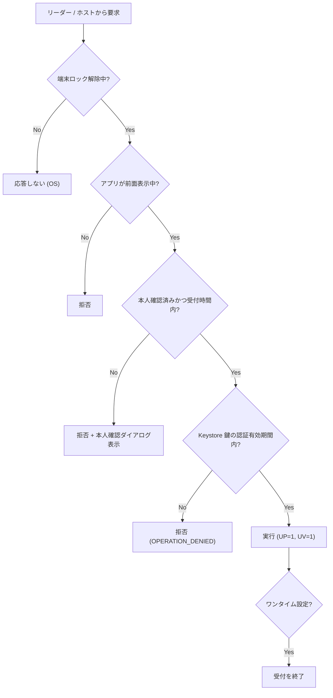

# BD-05 セキュリティ方針

| 項目 | 内容 |
|---|---|
| 文書番号 | TCAK-BD-05 |
| 版数 | 1.0 |
| 作成日 | 2026-11-02 |
| 関連文書 | BD-02 要件定義 (SEC)、DD-05 状態遷移、DD-07 鍵管理 |

## 1. 基本的な考え方

本アプリは **Web アプリケーションのテスト用ツール** (PRE-01) であり、物理セキュリティキーの代替ではない (PRE-02)。
したがって、セキュリティ対策の目的は「本番アカウントを守ること」ではなく、次の 2 点とする。

1. テストで使う鍵が、利用者の意図しないタイミング・相手に使われないこと
2. 鍵やテスト用アカウント情報が端末外へ流出しないこと

本番アカウントの保護を前提とした対策 (FIDO 認定水準の耐タンパ性、鍵のバックアップ・復旧、ベンダーアテステーション) は対象外とする。

## 2. 保護資産

| 資産 | 保管場所 | 機密性 | 完全性 |
|---|---|---|---|
| A-1 クレデンシャル秘密鍵 (EC P-256) | Android Keystore (StrongBox / TEE) | 高 | 高 |
| A-2 クレデンシャルのメタデータ (RP ID、ユーザー ID・名前、公開鍵、署名カウンタ) | アプリ専用領域 (AES-GCM 暗号化) | 中 | 中 |
| A-3 メタデータ暗号鍵 (AES-256) | Android Keystore | 高 | 高 |
| A-4 設定 | アプリ専用領域 (SharedPreferences) | 低 | 中 |
| A-5 イベントログ | メモリのみ | 低 | 低 |

## 3. 脅威と対策

| ID | 脅威 (STRIDE) | 内容 | 対策 | 要件 |
|---|---|---|---|---|
| T-01 | なりすまし (S) | 端末を拾得・一時的に借用した第三者が、近くのリーダーで認証する | 端末ロック中は HCE・鍵とも使用不可。認証には毎回本人確認が必要。受付時間を短く (既定 60 秒)、既定でワンタイム | SEC-02, SEC-03 |
| T-02 | なりすまし (S) | ポケット内の端末に、悪意あるリーダーを近づけて認証させる (リレー攻撃を含む) | アプリ前面表示中かつ本人確認直後のみ応答。それ以外は FIDO アプレット自体を見せない (`6A82`) | SEC-04 |
| T-03 | なりすまし (S) | 本人確認後の受付時間内に、意図しない RP の認証を行われる | ワンタイム (1 回で受付終了)。イベントログで RP を確認できる。受付時間の上限 300 秒 | FR-13 |
| T-04 | 改ざん (T) | メタデータファイルの改ざん (署名カウンタの巻き戻し等) | AES-GCM による認証付き暗号化。復号失敗時は読み込まない | SEC-05 |
| T-05 | 否認 (R) | — | テスト用途のため監査ログは持たない。イベントログはメモリのみ | SEC-08 |
| T-06 | 情報漏えい (I) | 秘密鍵の抽出 | Keystore 内生成・非エクスポート。StrongBox 優先 | SEC-01 |
| T-07 | 情報漏えい (I) | バックアップ・端末移行・画面キャプチャ経由の流出 | `allowBackup=false`、data extraction rules で全除外、`FLAG_SECURE` | SEC-06, SEC-07 |
| T-08 | 情報漏えい (I) | 本人確認前の応答から RP・ユーザー情報が漏れる | 受付外は CTAP 自体を受け付けない。ユーザー名・表示名は UV 済みの応答にのみ含める | SEC-04 |
| T-09 | サービス拒否 (D) | 不正な APDU / CBOR / HID パケットによる異常終了 | 長さ・型・ネスト深さの検証、例外を CTAP エラー / SW に変換 | SEC-10 |
| T-10 | 権限昇格 (E) | 他アプリが HCE サービスや内部 API を呼び出す | HCE サービスは `BIND_NFC_SERVICE` 権限で保護。その他のコンポーネントは非公開 | — |
| T-11 | なりすまし (S) | 削除・保護設定の無効化を第三者が行う | 削除、ワンタイム OFF、生体認証のみ OFF、リセット許可 ON に本人確認を要求 | SEC-09 |

## 4. 認可モデル (FR-11〜FR-14)

認証 (登録・署名) を受け付けるのは、次の **すべて** を満たす場合のみとする。

| 条件 | 制御主体 | 設定 |
|---|---|---|
| 端末ロック解除中 | OS (HCE の `requireDeviceUnlock`、鍵の `setUnlockedDeviceRequired`) | 固定 |
| アプリ前面表示中 | アプリ (Activity onStart〜onStop) | 固定 |
| 本人確認・受付時間 | アプリ (`AuthSessionManager`) | 15 / 30 / 60 / 120 / 300 秒 (既定 60) |
| 鍵の認証有効期間 | Keystore (`setUserAuthenticationParameters(300, …)`) | 固定 300 秒 |
| ワンタイム | アプリ | 既定 ON |
| 本人確認の手段 | BiometricPrompt | Class 3 生体認証 + 画面ロック (既定) / 生体認証のみ |

> Keystore の認証有効期間は、端末のロック解除でも開始される。そのため **アプリ側の受付状態が主たる制御** であり、
> Keystore 側の制限は多重防御として位置付ける。

## 5. 残存リスク (テスト用途として受容するもの)

| ID | リスク | 受容理由 |
|---|---|---|
| R-01 | 受付時間内 (最大 300 秒、ワンタイム OFF 時) は、近くのリーダーからの要求を区別できない | 利用者が操作中であり、テスト用途。ワンタイム既定 ON |
| R-02 | CTAP 処理がアプリプロセス上で動くため、OS / アプリの脆弱性の影響を受ける | 物理キーの代替としない (PRE-02) |
| R-03 | 鍵の喪失 (アンインストール等) を復旧できない | テスト用アカウントでの利用 (PRE-04) |
| R-04 | アテステーションで認証器の真正性を示せない | テスト用途。RP がアテステーションを検証する場合は自己アテステーションの扱いを確認する |
