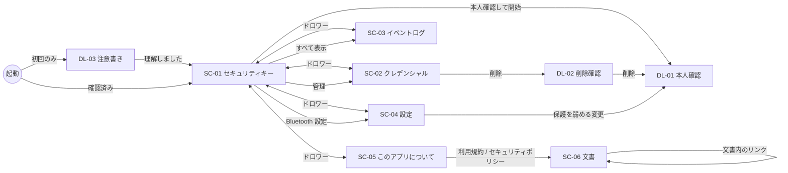

# BD-06 画面設計 (概要)

| 項目 | 内容 |
|---|---|
| 文書番号 | TCSKE-BD-06 |
| 版数 | 1.3 |
| 作成日 | 2026-11-02 |
| 改訂 | 1.3 (2026-11-03): アプリのアイコン (§6) を追加 |
| 改訂 | 1.2 (2026-11-02): 言語設定 (FR-19)、注意書きカードと初回起動時の注意書きダイアログ DL-03 (FR-20) を追加 |
| 関連文書 | DD-08 画面詳細 |

## 1. 画面一覧

| ID | 画面 | ルート | 概要 | 関連要件 |
|---|---|---|---|---|
| SC-01 | セキュリティキー (メイン) | `authenticator` | 受付状態、本人確認して開始/停止、接続方式、鍵の保管、最近のイベント | FR-11〜FR-15 |
| SC-02 | クレデンシャル | `credentials` | 登録済みクレデンシャルの一覧、個別削除、全削除 | FR-07〜FR-09 |
| SC-03 | イベントログ | `log` | CTAP コマンドの結果、接続イベント | FR-17 |
| SC-04 | 設定 | `settings` | 表示 (言語・テーマ)・本人確認・鍵・クライアント操作・Bluetooth の設定 | FR-16, FR-18, FR-19 |
| SC-05 | このアプリについて | `about` | バージョン、AAGUID、プロトコル、規約・ポリシー、セキュリティ説明、ライセンス | FR-20 |
| SC-06 | 文書 (利用規約・セキュリティポリシー) | `document/{id}` | リポジトリの Markdown 文書の表示 (戻る矢印で SC-05 へ) | FR-20 |
| DL-01 | 本人確認ダイアログ | (OS) | BiometricPrompt | FR-11 |
| DL-02 | 削除確認ダイアログ | — | 個別削除・全削除の確認 | FR-08, FR-09 |
| DL-03 | 注意書きダイアログ | — | 初回起動時に、テスト専用であること・物理キーの代替としないことを確認する (「理解しました」まで閉じない) | FR-20 |

## 2. 画面遷移



- すべての画面はドロワー (ナビゲーション) から相互に遷移できる。遷移時は SC-01 より上の画面を積まない (戻るで SC-01 に戻る)。
- 本人確認ダイアログは、NFC リーダー検出時・Bluetooth の要求時にも自動表示される (FR-15)。

## 3. レイアウト方針 (TCSameuraDamMonitor ベース)

| 項目 | 方針 |
|---|---|
| ナビゲーション | 画面幅 840dp 未満は `ModalNavigationDrawer` (左上のメニューアイコン)、840dp 以上は `PermanentDrawerSheet` の常設サイドバー (開閉可) |
| 上部バー | `TopAppBar` に画面タイトル (`AutoResizingSingleLineText` で自動縮小) |
| 本文 | 最大幅 720dp (ログは 960dp) で中央寄せ。縦スクロール + マウスドラッグスクロール |
| テーマ | Material 3。ダイナミックカラー対応、ライト/ダーク/システム設定に従う |
| エッジツーエッジ | ステータスバー・ナビゲーションバーを透過 |
| 通知 | 一時的なメッセージはスナックバー |
| 言語 | 英語 (既定)・日本語。端末の言語設定・アプリ別言語設定に従う |
| アクセシビリティ | 見出しの semantics、受付状態の live region、アイコンの contentDescription |
| セキュリティ | `FLAG_SECURE` (スクリーンショット・録画不可) |

## 4. TCSameuraDamMonitor から流用した部品

| 部品 | 流用元 | 本アプリでの用途 |
|---|---|---|
| `TCSecurityKeyEmulatorTheme` | `ui/theme/Theme.kt` (`TCSameuraDamMonitorTheme`) | アプリ全体のテーマ |
| `SettingsCategoryTitle`, `ThemeSettingItem`, `SettingItemSwitch`, `SettingItemReadOnly`, `SettingItemClickable`, `SettingsHelpText` | `ui/settings/SettingsCommonItems.kt` | 設定画面・このアプリについて |
| `SettingItemDropdown` (新規) | `ThemeSettingItem` を汎用化 | 受付時間・アテステーションの選択 |
| `Modifier.mouseDragScroll` | `ui/common/MouseDragScroll.kt` | 全画面のスクロール |
| `AutoResizingSingleLineText` | `ui/main/AdaptiveText.kt` | タイトル |
| ドロワー構成・`rememberNavigationLayout` (840dp 判定) | `ui/main/MainScreen.kt`, `DrawerContent.kt`, `DataDisplayComponents.kt` | `AppRoot` |
| エッジツーエッジ設定 | `MainActivity.kt` | `MainActivity` |

## 5. 画面イメージ (SC-01)

```
┌──────────────────────────────┐
│ ☰  セキュリティキー               │
├──────────────────────────────┤
│ ┌──────────────────────────┐ │
│ │ 🔓 認証できます              │ │
│ │    残り 42 秒                │ │
│ │ ▓▓▓▓▓▓▓▓▓▓▓░░░░░░           │ │
│ │ 本端末の背面を NFC リーダーに │ │
│ │ かざしてください…            │ │
│ │ [ 停止 ]                    │ │
│ └──────────────────────────┘ │
│ 接続方式                        │
│  NFC        利用可能            │
│  Bluetooth  設定で無効 [設定]    │
│  USB        非対応              │
│ 鍵の保管                        │
│  Android キーストア (StrongBox)  │
│  3 件のクレデンシャル    [管理]   │
│ 最近のイベント                   │
│  12:34:56 [NFC] GetAssertion…  │
└──────────────────────────────┘
```

## 6. アプリのアイコン

| 項目 | 内容 |
|---|---|
| 形式 | アダプティブアイコン (`mipmap-anydpi/ic_launcher.xml`)。minSdk 35 のためビットマップは持たない |
| 図形 | Material Symbols「security_key」(Outlined。Apache License 2.0) を 108dp のレイヤーの中央 56dp に配置 (セーフゾーン 66dp 内) |
| 配色 | ライトテーマ: 背景 白 `#FFFFFF`、図形 `#1E5AA8`。ダークテーマ: 背景 `#1B1B1F`、図形 `#A8C7FA` (`values` / `values-night` の `ic_launcher_colors.xml`。端末のダークテーマ設定に追従する) |
| テーマアイコン | Android 13 以降の「テーマアイコン」用に単色レイヤー (`ic_launcher_monochrome.xml`) を持つ。色はランチャーが壁紙に合わせて付ける |

