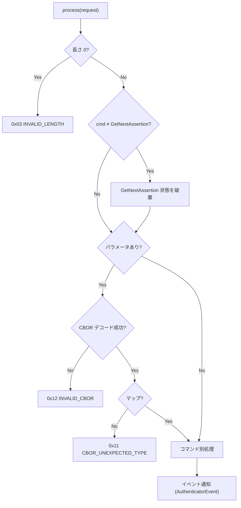
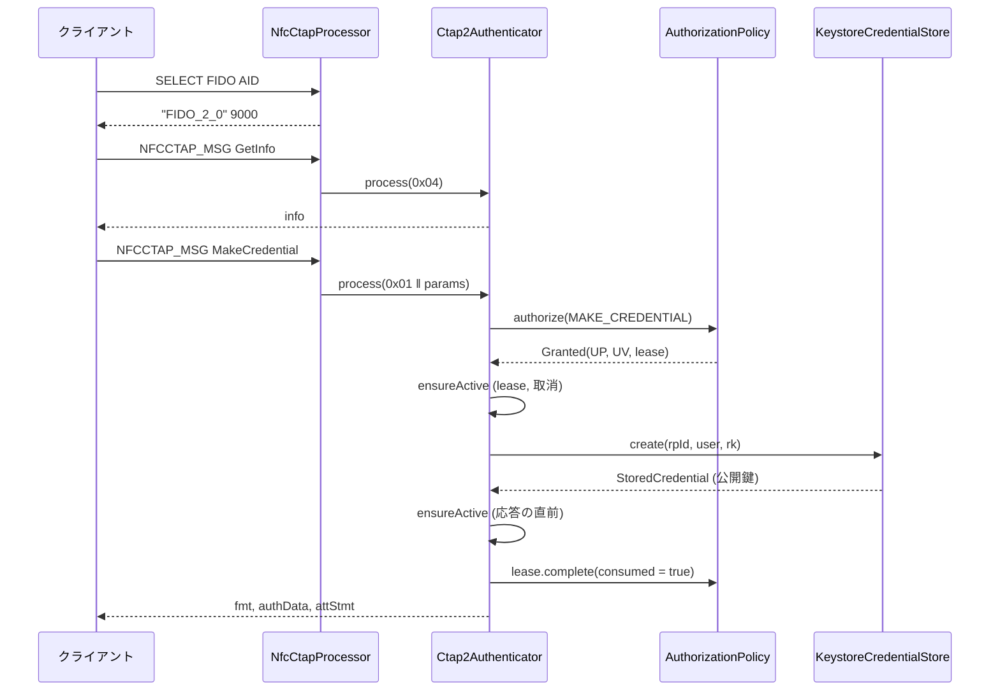
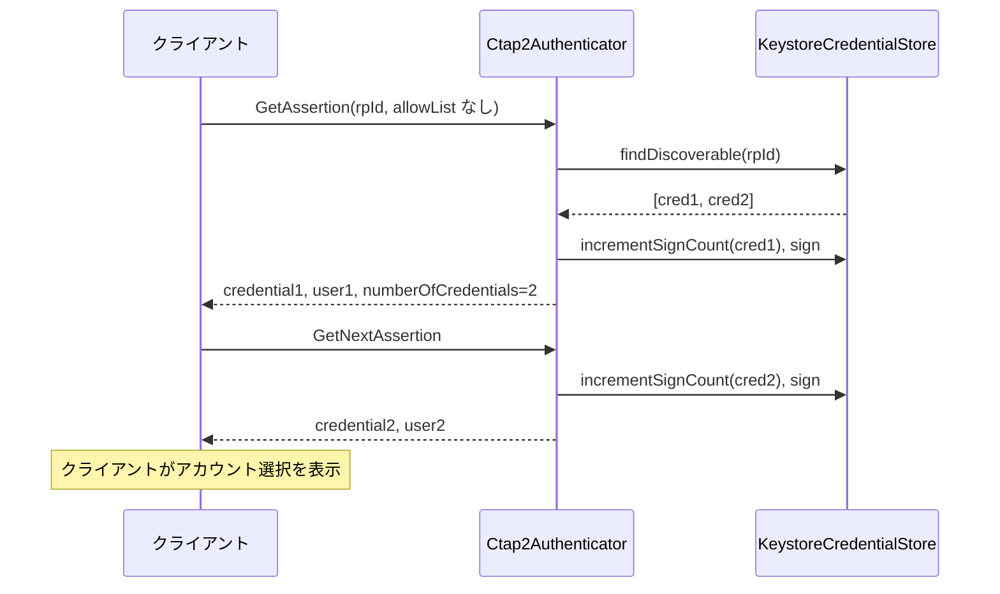

# DD-01 CTAP2 プロトコル

| 項目 | 内容 |
|---|---|
| 文書番号 | TCSKE-DD-01 |
| 版数 | 1.3 |
| 作成日 | 2026-11-02 |
| 改訂 | 1.3 (2026-11-05): hmac-secret 拡張と authenticatorClientPIN の getKeyAgreement を追加 (§2、§3、§4、§7、§8、§11) |
| 改訂 | 1.2 (2026-11-05): PIN/UV Auth Protocol 1 / 2 の暗号処理 (§10) を追加 (コマンドからはまだ使わない) |
| 改訂 | 1.1 (2026-11-02): 外部レビュー対応 (認可の Lease 化、入力検証・処理順序・UP/UV・allowList・GetNextAssertion・上書き登録・CBOR の厳密化)。`review/FIX_PLAN.md` |
| 実装 | `fido-core/.../ctap2/Ctap2Authenticator.kt`, `CtapConstants.kt`, `cbor/Cbor.kt`, `ctap2/ClientPin.kt`, `ctap2/HmacSecret.kt`, `pin/PinUvAuthProtocol.kt`, `pin/CoseEcdhKey.kt`, `pin/Hkdf.kt` |
| 関連要件 | FR-04〜FR-06, FR-10, FR-16, FR-21, SEC-10 |

## 1. 共通仕様

### 1.1 メッセージ形式

| 方向 | 形式 |
|---|---|
| 要求 | `コマンド (1 バイト) ‖ CBOR マップ (任意)` |
| 応答 | `ステータス (1 バイト) ‖ CBOR マップ (成功時のみ、任意)` |

### 1.2 CBOR

- エンコードは CTAP2 canonical 形式: 整数は最短表現、マップのキーは「メジャータイプ → エンコード長 → バイト列の辞書順」で整列、重複キーはエラー。
- デコードで受け付ける型: 整数 (`Long`)、バイト列、テキスト、配列、マップ (キーは整数またはテキスト)、真偽値、null、浮動小数点。
- 拒否する入力: 不定長、最短でない整数・長さの表現 (例 `18 01`)、タグ、不正な UTF-8、データ長を超える長さ宣言、
  ネスト 16 段超、末尾の余剰バイト、マップキーの重複・不正型。
- マップキーの並び順は検証しない (CTAP 2.0 §6 ではデコーダの検証は推奨であり、クライアントとの互換性を優先する)。

### 1.3 共通処理

- 未知のコマンド・非対応コマンド (CredentialManagement 0x0A 等) は `0x01 INVALID_COMMAND`。ClientPIN (0x06) は §11.1。
- 処理中の `CtapException` はそのステータス、その他の例外 (`IOException`・`KeyStoreException` 等を含むすべて) は
  `0x7F ERR_OTHER` を返し、トランスポートのスレッドへ例外を漏らさない。
- `process(request, keepAlive, channel)` の `keepAlive` はその要求専用の取消トークン、`channel` は受信チャネル
  (CTAPHID の CID。NFC は 0) で、GetNextAssertion の対応付けに使う。
- すべてのコマンドで、結果 (コマンド・ステータス・RP ID・ユーザー名・詳細) を `AuthenticatorEventListener` に通知する。

### 1.4 認可 (AuthorizationPolicy)

ユーザー操作を伴う処理は `AuthorizationPolicy.authorize(AuthorizationRequest, KeepAlive)` を呼ぶ。

| 項目 | 内容 |
|---|---|
| 要求内容 | 操作種別 (`MAKE_CREDENTIAL` / `GET_ASSERTION` / `RESET` / `SELECTION`)、RP ID、ユーザー名、UP 要否、UV 要否 |
| 結果 | `Granted(userPresent, userVerified, lease)` または `Denied(status, reason)` |
| 有効性の確認 | 鍵の生成・署名の直前と応答の直前に `lease.isValid()` と取消トークンを確認 (`ensureActive`)。失効は `0x27`、取消は `0x2D` |
| 完了 | 許可された操作は、すべての経路で `lease.complete(consumed)` を 1 回呼ぶ。`consumed` = 成功かつ UP または UV を伴う (ワンタイム消費) |

Android 実装の判定内容と Lease の寿命は DD-05 §2 を参照。

## 2. authenticatorGetInfo (0x04)

パラメータなし。認可不要。

| キー | 名前 | 値 |
|---|---|---|
| 0x01 | versions | `["FIDO_2_0"]` |
| 0x02 | extensions | `["hmac-secret"]` (§11.2) |
| 0x03 | aaguid | `523283ca3c2c48b58bffa722f900e190` (16 バイト) |
| 0x04 | options | `{"rk": true, "up": true, "uv": true, "plat": false}` |
| 0x05 | maxMsgSize | 2048 |
| 0x06 | pinProtocols | `[1]` (§11.1。鍵交換のみに対応) |
| 0x09 | transports | NFC: `["nfc"]`、Bluetooth HID: `["usb"]` (§2.1) |
| 0x0A | algorithms | `[{"alg": -7, "type": "public-key"}]` |

- `clientPin` を含めない = PIN 非対応。`pinProtocols` は hmac-secret の鍵交換 (getKeyAgreement) に使う Protocol 1 のみを示す。
  対応しない PIN プロトコルを広告してクライアントの制約を回避することはしない (BD-04 §5 の注記を参照)。

### 2.1 Bluetooth HID の transports を `usb` とする理由

外部レビュー (F-14) で「Bluetooth 接続なのに `usb`」と指摘されたが、変更しない。

- Bluetooth Classic HID の上で CTAPHID をそのまま使っており、ホスト OS・クライアントからは HID の FIDO デバイスとして見える。
  クライアントは HID デバイスを USB HID の transport として扱う (Chromium の `kUsbHumanInterfaceDevice` 等)。
- `ble` は FIDO の BLE トランスポート (GATT) を意味するため、本アプリの Bluetooth HID には当てはまらない。
- transports は任意項目で、クライアントが credential の transport ヒントに使う程度であり、実害は小さい。

## 3. authenticatorMakeCredential (0x01)

### 3.1 パラメータ

| キー | 名前 | 型 | 必須 | 扱い |
|---|---|---|---|---|
| 0x01 | clientDataHash | bytes | ○ | 32 バイト (SHA-256)。自己アテステーションの署名対象 |
| 0x02 | rp | map | ○ | `id` (必須・text)、`name` (任意) |
| 0x03 | user | map | ○ | `id` (必須・1〜64 バイト)、`name`、`displayName` |
| 0x04 | pubKeyCredParams | array | ○ | `{"type": "public-key", "alg": -7}` が含まれること |
| 0x05 | excludeList | array | | `type` = `public-key` の `id` を照合 |
| 0x06 | extensions | map | | `hmac-secret` (真偽値。§11.2)。未知の拡張は無視 |
| 0x07 | options | map | | `rk` (既定 false)、`uv` (既定 false)、`up` (false は不可、true は互換性のため許容) |
| 0x08 | pinAuth | bytes | | §3.3 |
| 0x09 | pinProtocol | uint | | 整数であることのみ検証 |

### 3.2 処理順序

| # | 処理 | エラー |
|---|---|---|
| 1 | 必須パラメータの存在・型を確認。clientDataHash が 32 バイトでない | 欠落 `0x14 MISSING_PARAMETER`、型不正 `0x11`、長さ不正 `0x03 INVALID_LENGTH` |
| 2 | `rp.id`、`user.id` を取得。`user.id` が 0 バイトまたは 65 バイト以上 | `0x02 INVALID_PARAMETER` |
| 3 | pubKeyCredParams・excludeList・extensions・options・pinAuth・pinProtocol の型を確認 | `0x11` / `0x14` |
| 4 | excludeList に同一 RP の登録済み ID があれば、認可 (存在確認) 後に拒否 (CTAP 2.0 §5.1 手順 1) | `0x19 CREDENTIAL_EXCLUDED` |
| 5 | pubKeyCredParams に `public-key` / ES256 がない | `0x26 UNSUPPORTED_ALGORITHM` |
| 6 | options の `up: false` | `0x2C INVALID_OPTION` |
| 7 | pinAuth の確認 (§3.3) | `0x35` / `0x33` |
| 8 | 認可 (UP 必須、UV = options.uv) | `Denied` のステータス |
| 9 | 有効性の確認 → 鍵ペア生成・メタデータ保存 (`CredentialStore.create`)。`hmac-secret: true` なら CredRandom も作る | 失効 `0x27`、生成失敗 `0x27 OPERATION_DENIED` |
| 10 | authenticatorData (§7) を作成。フラグ UP・AT、認可で UV 済みなら UV。`hmac-secret: true` を要求された場合は ED と拡張 `{"hmac-secret": true}` | |
| 11 | 有効性の確認 → アテステーション作成 (§3.4) | 署名不可 `0x27` |
| 12 | 有効性の確認 (応答の直前) | 失効 `0x27` |
| 13 | `rk: true` なら、同一 RP・同一 `user.id` で新しい credential より前に作成された discoverable credential を削除 (上書き登録) | 削除の失敗は無視 (旧 credential が残るだけ) |
| 14 | `lease.complete(consumed = 成功)`。応答を返さなかった場合は、手順 9 で作成した credential を削除する | |

> 上書き登録では、旧 credential の削除を新しい登録の完成後に行う (手順 13)。鍵生成・保存・アテステーションの
> いずれかが失敗しても、既存の credential は使えるまま残る。

### 3.3 pinAuth の扱い (clientPIN 非対応)

| 入力 | 処理 |
|---|---|
| pinAuth なし | 通常処理 |
| 長さ 0 の pinAuth (プラットフォームのタッチ待ちプローブ) | 認可 (UP) 後に `0x35 PIN_NOT_SET` (Lease は消費せずに完了する) |
| 長さ 1 以上の pinAuth | `0x33 PIN_AUTH_INVALID` |

GetAssertion (キー 0x06) も同様に扱う。

### 3.4 アテステーション

| 設定 | fmt | attStmt |
|---|---|---|
| なし (既定) | `"none"` | `{}` |
| 自己アテステーション | `"packed"` | `{"alg": -7, "sig": ECDSA(クレデンシャル秘密鍵, authenticatorData ‖ clientDataHash)}` (x5c なし) |

### 3.5 応答

| キー | 名前 | 値 |
|---|---|---|
| 0x01 | fmt | §3.4 |
| 0x02 | authData | §7 (attestedCredentialData を含む) |
| 0x03 | attStmt | §3.4 |

## 4. authenticatorGetAssertion (0x02)

### 4.1 パラメータ

| キー | 名前 | 型 | 必須 | 扱い |
|---|---|---|---|---|
| 0x01 | rpId | text | ○ | |
| 0x02 | clientDataHash | bytes | ○ | 32 バイト (SHA-256)。署名対象 |
| 0x03 | allowList | array | | `type` = `public-key` の `id`。空でなければ、そのリストに限定する |
| 0x04 | extensions | map | | `hmac-secret` (§11.2)。未知の拡張は無視 |
| 0x05 | options | map | | `up` (既定 true)、`uv` (既定 false)、`rk` があれば `0x2C INVALID_OPTION` |
| 0x06 | pinAuth | bytes | | §3.3 |
| 0x07 | pinProtocol | uint | | 整数であることのみ検証 |

### 4.2 処理順序

| # | 処理 | エラー |
|---|---|---|
| 1 | 必須パラメータ・型の確認 (clientDataHash 32 バイト)、options 解釈 | `0x14` / `0x11` / `0x03` / `0x2C` |
| 1a | hmac-secret の入力があれば、`up: false` を拒否し、入力を検証して salt を復号する (§11.2)。認可の前に行う | `0x2B` / `0x02` / `0x33` 等 |
| 2 | pinAuth の確認 | `0x35` / `0x33` |
| 3 | 認可 (UP = options.up、UV = options.uv)。credential の有無を返す前に行う (認可前の存在確認を防ぐ) | `Denied` のステータス |
| 4 | 対象クレデンシャルの決定: allowList が空でなければ「同一 RP かつ ID 一致」(対応 type の ID が 0 件なら 0 件)、allowList なし・空なら「同一 RP の discoverable を作成日時の新しい順」 | 0 件 `0x2E NO_CREDENTIALS` |
| 5 | フラグ決定: UP = `options.up` かつ許可。UV = 許可で UV 済み かつ (UP または `options.uv`)。`options.uv` なのに UV 未実施なら拒否 | `0x27` |
| 6 | 有効性の確認 → 先頭のクレデンシャルで署名カウンタを +1 し、authenticatorData (37 バイト。hmac-secret の出力があれば ED と拡張を付ける) を作成して署名 → 有効性の確認 | 失効・署名不可 `0x27` |
| 7 | allowList なし・空で 2 件以上なら `numberOfCredentials` を付け、残りを GetNextAssertion 用に保持 (Lease・取消トークン・チャネルも保持) | |
| 8 | `lease.complete(consumed = 成功 かつ (UP または UV))`。silent assertion (`up: false, uv: false`) はワンタイムを消費しない | |

| options | flags | ワンタイム |
|---|---|---|
| `up: true` (既定)、`uv` 任意 | UP・UV | 消費 |
| `up: false, uv: true` | UV | 消費 |
| `up: false, uv: false` (silent) | なし | 消費しない |

### 4.3 応答

| キー | 名前 | 値 |
|---|---|---|
| 0x01 | credential | `{"id": <credentialId>, "type": "public-key"}` |
| 0x02 | authData | rpIdHash ‖ flags ‖ signCount (‖ 拡張。§11.2) |
| 0x03 | signature | ECDSA (DER) over `authData ‖ clientDataHash` |
| 0x04 | user | discoverable credential の場合のみ。`{"id"}`、UV 済みなら `name` / `displayName` も含める |
| 0x05 | numberOfCredentials | allowList なしで 2 件以上の場合のみ |

## 5. authenticatorGetNextAssertion (0x08)

| 条件 | 結果 |
|---|---|
| 直前のコマンドが GetAssertion で、残りがあり、継続が有効 | 次のクレデンシャルの応答 (§4.3 の 0x01〜0x04)。フラグは最初の GetAssertion と同じ |
| 状態なし / 他のコマンドを挟んだ / 直前の成功から 30 秒経過 / 残りなし | `0x30 NOT_ALLOWED` |
| 別のチャネル (CID) から / 元の要求の取消・切断後 / 受付の明示的な停止・前面離脱後 | `0x30 NOT_ALLOWED` (状態を破棄) |

- 認可は再度行わず、元の GetAssertion の Lease で継続する。ワンタイムの消費後も継続できる (DD-05 §2.4)。
- 30 秒のタイマーは単調時計で計り、成功の都度リセットする (CTAP 2.0 §5.3)。
- 次の位置への移動は署名に成功してから行う (署名に失敗しても、同じクレデンシャルを再度取得できる)。
- 署名カウンタはクレデンシャル毎に +1 する。
- hmac-secret の入力があった場合は、元の GetAssertion で復号した salt と共有鍵で、各クレデンシャルの出力を作る。

## 6. authenticatorReset (0x07) / authenticatorSelection (0x0B)

| コマンド | 処理 |
|---|---|
| Reset | 設定「PC からのリセットを許可」が OFF なら認可前に `0x27 OPERATION_DENIED`。ON なら認可 (UP・UV) 後に全クレデンシャルを削除し、鍵交換の鍵を作り直して `0x00` |
| Selection | 認可 (UP) 後に `0x00`。ワンタイムは消費しない (`complete(false)`) |

## 7. authenticatorData

| オフセット | 長さ | 内容 |
|---|---|---|
| 0 | 32 | rpIdHash = SHA-256(rpId の UTF-8) |
| 32 | 1 | flags: bit0 UP、bit2 UV、bit6 AT (登録時)、bit7 ED (拡張あり) |
| 33 | 4 | signCount (ビッグエンディアン) |
| 37 | 16 | (登録時) AAGUID |
| 53 | 2 | (登録時) credentialId 長 L (= 32) |
| 55 | L | (登録時) credentialId |
| 55+L | 77 | (登録時) 公開鍵 COSE_Key `{1: 2 (EC2), 3: -7 (ES256), -1: 1 (P-256), -2: x (32), -3: y (32)}` |
| 末尾 | 可変 | (ED のとき) 拡張の CBOR マップ (§11.2) |

## 8. ステータスコード一覧 (使用するもの)

| 値 | 名前 | 主な発生箇所 |
|---|---|---|
| 0x00 | OK | 成功 |
| 0x01 | INVALID_COMMAND | 未対応コマンド |
| 0x02 | INVALID_PARAMETER | user.id の長さ不正、未対応の pinUvAuthProtocol、鍵交換の公開鍵の不正、salt の復号失敗・長さ不正 (§11) |
| 0x03 | INVALID_LENGTH | 空の要求、clientDataHash が 32 バイトでない |
| 0x11 | CBOR_UNEXPECTED_TYPE | 型不正 |
| 0x12 | INVALID_CBOR | CBOR デコード失敗 |
| 0x14 | MISSING_PARAMETER | 必須パラメータ欠落 |
| 0x19 | CREDENTIAL_EXCLUDED | excludeList 一致 |
| 0x22 | INVALID_CREDENTIAL | 鍵・メタデータの不整合 |
| 0x26 | UNSUPPORTED_ALGORITHM | ES256 非指定 |
| 0x27 | OPERATION_DENIED | 前面表示外・未確認 (NFC)・他の操作がワンタイムを予約中・認可の失効・鍵生成/署名不可・UV 未実施・リセット不許可 |
| 0x2B | UNSUPPORTED_OPTION | hmac-secret の入力と `up: false` の組み合わせ |
| 0x2C | INVALID_OPTION | `up: false` (登録)、`rk` 指定 (認証) |
| 0x2D | KEEPALIVE_CANCEL | ホストからのキャンセル (Bluetooth)、要求の取消 |
| 0x2E | NO_CREDENTIALS | 該当クレデンシャルなし |
| 0x2F | USER_ACTION_TIMEOUT | 本人確認待ちのタイムアウト (Bluetooth) |
| 0x30 | NOT_ALLOWED | GetNextAssertion の状態なし・期限切れ・失効・チャネル不一致 |
| 0x33 | PIN_AUTH_INVALID | 長さ 1 以上の pinAuth、hmac-secret の saltAuth の不一致 |
| 0x35 | PIN_NOT_SET | 長さ 0 の pinAuth |
| 0x3E | INVALID_SUBCOMMAND | ClientPIN の未対応のサブコマンド |
| 0x7F | OTHER | 想定外の例外、メタデータの読み込み・保存の失敗 (DD-07) |

## 9. シーケンス

### 9.1 登録 (NFC、本人確認済み)

### 9.2 パスキーでの認証 (複数アカウント)

## 10. PIN/UV Auth Protocol

CTAP 2.1 §6.5 の PIN/UV Auth Protocol の認証器側を `fido.pin.PinUvAuthProtocol` に実装する。
clientPIN (0x06) の鍵交換、hmac-secret 拡張、pinUvAuthToken の検証で共通に使う。現時点では ClientPIN の getKeyAgreement と hmac-secret (§11) で使う。

### 10.1 共通

| 操作 | 内容 |
|---|---|
| 鍵交換の鍵ペア | P-256 のソフトウェア鍵 (メモリ上のみ)。インスタンスの生成時と `regenerate()` で作り直す |
| `getPublicKey()` | COSE_Key `{1: 2 (EC2), 3: -25, -1: 1 (P-256), -2: x, -3: y}`。alg の -25 は仕様上の固定値 |
| `decapsulate(peerCoseKey)` | 相手の COSE_Key を検証し (§10.4)、ECDH の結果 Z (x 座標、32 バイト) から共有鍵を導出する |
| `verify(key, message, signature)` | `authenticate(key, message)` と `signature` を定数時間で比較する (`MessageDigest.isEqual`)。長さが違えば不一致 |

暗号処理は JCA (`KeyAgreement("ECDH")`、`Cipher("AES/CBC/NoPadding")`、`Mac("HmacSHA256")`) のみを使い、外部ライブラリを追加しない。
入力の不正は `PinUvAuthProtocolException` とし、呼び出し側が CTAP のステータスに変換する。インスタンスはスレッドセーフではない
(`Ctap2Authenticator.process` が直列化する)。

### 10.2 Protocol 1

| 項目 | 内容 |
|---|---|
| 共有鍵 | SHA-256(Z) (32 バイト) |
| encrypt / decrypt | AES-256-CBC、IV はすべて 0。平文・暗号文は空でない 16 バイトの倍数 |
| authenticate | HMAC-SHA-256(key, message) の先頭 16 バイト。key は共有鍵または pinUvAuthToken (16 / 32 バイト) |

### 10.3 Protocol 2

| 項目 | 内容 |
|---|---|
| 共有鍵 | HMAC 鍵 ‖ AES 鍵 (計 64 バイト)。各 32 バイトを HKDF-SHA-256 (salt = 32 バイトの 0、info = `"CTAP2 HMAC key"` / `"CTAP2 AES key"`) で導出 |
| encrypt | AES-256-CBC (AES 鍵)。ランダムな IV (16 バイト) を暗号文の先頭に付ける |
| decrypt | 先頭 16 バイトを IV とする。IV を除いた部分が空でない 16 バイトの倍数でなければ不正 |
| authenticate | HMAC-SHA-256 (32 バイト)。key が共有鍵 (64 バイト) なら先頭の HMAC 鍵、pinUvAuthToken (32 バイト) ならそのまま使う |

HKDF は `fido.pin.Hkdf` (RFC 5869) で実装し、RFC 5869 付録 A のテストベクタで確認する (DD-10 UT-112)。

### 10.4 相手の公開鍵の検証

| 条件 | 不正の例 |
|---|---|
| kty = 2 (EC2)、crv = 1 (P-256) | OKP、P-384 |
| alg は省略可。指定されていれば -25 | -7 |
| x・y が 32 バイトのバイト列 | 31 バイト、テキスト |
| x・y が体の範囲内 (0 ≤ x, y < p) で、y² = x³ − 3x + b (mod p) を満たす | 曲線外の点 (無効曲線攻撃の防止) |

## 11. ClientPIN の鍵交換と hmac-secret 拡張

### 11.1 authenticatorClientPIN (0x06)

対応するサブコマンドは getKeyAgreement (0x02) のみ。PIN の設定・トークンの発行には対応しない (GetInfo に `clientPin` を含めない)。
認可は不要 (鍵交換の公開鍵を返すだけで、鍵や credential を使わない)。

| キー | 名前 | 型 | 必須 | 扱い |
|---|---|---|---|---|
| 0x01 | pinUvAuthProtocol | uint | ○ | 1 のみ。それ以外は `0x02 INVALID_PARAMETER` |
| 0x02 | subCommand | uint | ○ | 0x02 以外は `0x3E INVALID_SUBCOMMAND` |

応答: `{1: keyAgreement}` (§10.1 の COSE_Key)。鍵交換の鍵は `Ctap2Authenticator` のインスタンス (トランスポート) ごとに持ち、
インスタンスの生成時と Reset で作り直す。

### 11.2 hmac-secret

credential ごとに 32 バイトの秘密値 CredRandom を 2 つ (UV あり用・UV なし用) 持ち、プラットフォームが送る salt に対して
`HMAC-SHA-256(CredRandom, salt)` を返す (CTAP 2.1 §12.5)。WebAuthn の PRF 拡張はこの拡張で実現される。
CredRandom の保管は DD-07 §6。

**MakeCredential**

| 入力 | 処理 | 出力 (authData の拡張、ED) |
|---|---|---|
| `"hmac-secret": true` | CredRandom を作る (`CredentialOptions(hmacSecret = true)`)。作れなければ登録全体を `0x27` で失敗させる | `{"hmac-secret": true}` |
| `"hmac-secret": false`、なし | 作らない | なし |
| 真偽値以外 | `0x11 CBOR_UNEXPECTED_TYPE` | — |

**GetAssertion の入力** (`"hmac-secret": {1: keyAgreement, 2: saltEnc, 3: saltAuth, 4: pinUvAuthProtocol}`)

| # | 処理 | エラー |
|---|---|---|
| 1 | `up: false` との組み合わせを拒否する | `0x2B UNSUPPORTED_OPTION` |
| 2 | 入力が map で、1〜3 があり型が正しいこと。4 は省略可 (省略時は Protocol 1) | 欠落 `0x14`、型不正 `0x11` |
| 3 | プロトコルの選択 | 未対応 `0x02`。省略で Protocol 1 に未対応なら `0x33` |
| 4 | `decapsulate(keyAgreement)` で共有鍵を導出 (§10.4 の検証を含む) | `0x02 INVALID_PARAMETER` |
| 5 | `verify(共有鍵, saltEnc, saltAuth)` | `0x33 PIN_AUTH_INVALID` |
| 6 | saltEnc を復号し、32 バイト (salt1) または 64 バイト (salt1 ‖ salt2) であること | `0x02 INVALID_PARAMETER` |

手順 1〜6 は認可の前に行う (不正な入力でワンタイムの受付を使わない。credential の有無には依存しない)。

**GetAssertion の出力** (各 credential の応答ごと)

- 応答の UV フラグが立っていれば CredRandomWithUV、立っていなければ CredRandomWithoutUV を使う。
- `encrypt(共有鍵, HMAC(CredRandom, salt1) [‖ HMAC(CredRandom, salt2)])` を authData の拡張 `{"hmac-secret": <暗号文>}` とし、ED を立てる。
  署名は拡張を含む authData に対して行う。
- CredRandom のない credential (hmac-secret なしで登録) では拡張を無視し、出力を付けない。
- CredRandom を取得できない (Keystore の認証期限切れ等) 場合は `0x27 OPERATION_DENIED`。
- GetNextAssertion でも、元の GetAssertion の salt と共有鍵で同様に出力を作る。

