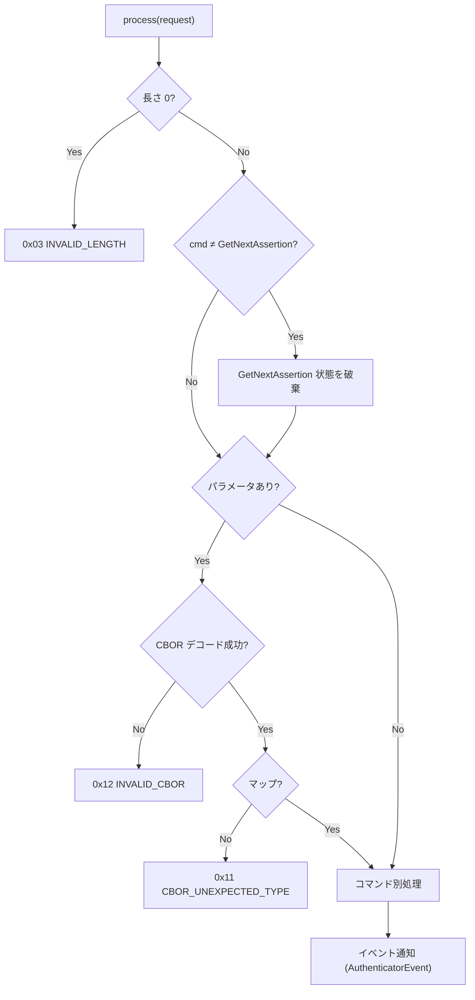
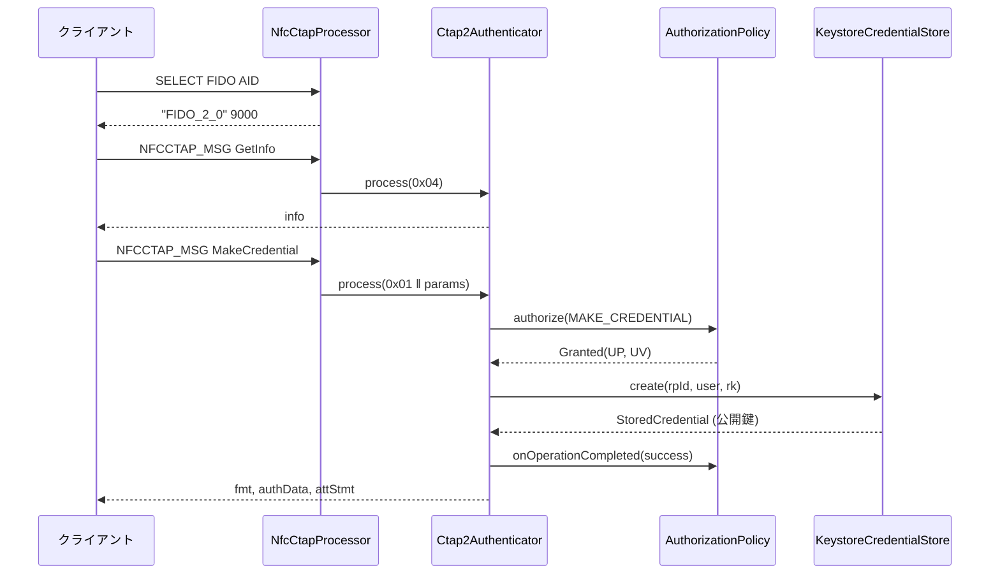
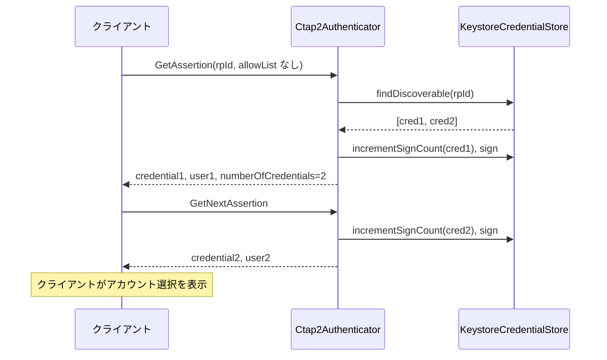

# DD-01 CTAP2 プロトコル

| 項目 | 内容 |
|---|---|
| 文書番号 | TCAK-DD-01 |
| 版数 | 1.0 |
| 作成日 | 2026-11-02 |
| 実装 | `fido-core/.../ctap2/Ctap2Authenticator.kt`, `CtapConstants.kt`, `cbor/Cbor.kt` |
| 関連要件 | FR-04〜FR-06, FR-10, FR-16, SEC-10 |

## 1. 共通仕様

### 1.1 メッセージ形式

| 方向 | 形式 |
|---|---|
| 要求 | `コマンド (1 バイト) ‖ CBOR マップ (任意)` |
| 応答 | `ステータス (1 バイト) ‖ CBOR マップ (成功時のみ、任意)` |

### 1.2 CBOR

- エンコードは CTAP2 canonical 形式: 整数は最短表現、マップのキーは「メジャータイプ → エンコード長 → バイト列の辞書順」で整列、重複キーはエラー。
- デコードで受け付ける型: 整数 (`Long`)、バイト列、テキスト、配列、マップ (キーは整数またはテキスト)、真偽値、null、浮動小数点、タグ (無視)。
- 拒否する入力: 不定長、データ長を超える長さ宣言、ネスト 16 段超、末尾の余剰バイト、マップキーの重複・不正型。

### 1.3 共通処理

- 未知のコマンド・非対応コマンド (ClientPIN 0x06、CredentialManagement 0x0A 等) は `0x01 INVALID_COMMAND`。
- 処理中の `CtapException` はそのステータス、その他の実行時例外は `0x7F ERR_OTHER` を返す。
- すべてのコマンドで、結果 (コマンド・ステータス・RP ID・ユーザー名・詳細) を `AuthenticatorEventListener` に通知する。

### 1.4 認可 (AuthorizationPolicy)

ユーザー操作を伴う処理は `AuthorizationPolicy.authorize(AuthorizationRequest, KeepAlive)` を呼ぶ。

| 項目 | 内容 |
|---|---|
| 要求内容 | 操作種別 (`MAKE_CREDENTIAL` / `GET_ASSERTION` / `RESET` / `SELECTION`)、RP ID、ユーザー名、UP 要否、UV 要否 |
| 結果 | `Granted(userPresent, userVerified)` または `Denied(status, reason)` |
| 完了通知 | 許可された操作の完了時に `onOperationCompleted(request, success)` (ワンタイム消費に使用) |

Android 実装の判定内容は DD-05 §2 を参照。

## 2. authenticatorGetInfo (0x04)

パラメータなし。認可不要。

| キー | 名前 | 値 |
|---|---|---|
| 0x01 | versions | `["FIDO_2_0"]` |
| 0x03 | aaguid | `523283ca3c2c48b58bffa722f900e190` (16 バイト) |
| 0x04 | options | `{"rk": true, "up": true, "uv": true, "plat": false}` |
| 0x05 | maxMsgSize | 2048 |
| 0x09 | transports | NFC: `["nfc"]`、Bluetooth HID: `["usb"]` |
| 0x0A | algorithms | `[{"alg": -7, "type": "public-key"}]` |

- `clientPin` を含めない = PIN 非対応。`extensions` (0x02)・`pinProtocols` (0x06) は含めない。

## 3. authenticatorMakeCredential (0x01)

### 3.1 パラメータ

| キー | 名前 | 型 | 必須 | 扱い |
|---|---|---|---|---|
| 0x01 | clientDataHash | bytes | ○ | 自己アテステーションの署名対象 |
| 0x02 | rp | map | ○ | `id` (必須・text)、`name` (任意) |
| 0x03 | user | map | ○ | `id` (必須・1〜64 バイト)、`name`、`displayName` |
| 0x04 | pubKeyCredParams | array | ○ | `{"type": "public-key", "alg": -7}` が含まれること |
| 0x05 | excludeList | array | | `type` = `public-key` の `id` を照合 |
| 0x06 | extensions | map | | 無視 |
| 0x07 | options | map | | `rk` (既定 false)、`uv` (既定 false)、`up` (false は不可) |
| 0x08 | pinAuth | bytes | | §3.3 |
| 0x09 | pinProtocol | uint | | 無視 |

### 3.2 処理順序

| # | 処理 | エラー |
|---|---|---|
| 1 | 必須パラメータの存在・型を確認 | 欠落 `0x14 MISSING_PARAMETER`、型不正 `0x11` |
| 2 | `rp.id`、`user.id` を取得。`user.id` が 0 バイトまたは 65 バイト以上 | `0x02 INVALID_PARAMETER` |
| 3 | pubKeyCredParams から `public-key` / ES256 を探す | 無し `0x26 UNSUPPORTED_ALGORITHM` |
| 4 | options を解釈。`up: false` | `0x2C INVALID_OPTION` |
| 5 | pinAuth の確認 (§3.3) | `0x35` / `0x33` |
| 6 | excludeList に同一 RP の登録済み ID があれば、認可 (存在確認) 後に拒否 | `0x19 CREDENTIAL_EXCLUDED` |
| 7 | 認可 (UP 必須、UV = options.uv) | `Denied` のステータス |
| 8 | `rk: true` なら、同一 RP・同一 `user.id` の既存 discoverable credential を削除 (上書き登録) | |
| 9 | 鍵ペア生成・メタデータ保存 (`CredentialStore.create`) | 生成失敗 `0x27 OPERATION_DENIED` |
| 10 | authenticatorData (§7) を作成。フラグ UP・AT、認可で UV 済みなら UV | |
| 11 | アテステーション作成 (§3.4) | 署名不可 `0x27` (作成した鍵は削除) |
| 12 | 完了通知 (成功 / 失敗) | |

### 3.3 pinAuth の扱い (clientPIN 非対応)

| 入力 | 処理 |
|---|---|
| pinAuth なし | 通常処理 |
| 長さ 0 の pinAuth (プラットフォームのタッチ待ちプローブ) | 認可 (UP) 後に `0x35 PIN_NOT_SET` |
| 長さ 1 以上の pinAuth | `0x33 PIN_AUTH_INVALID` |

GetAssertion (キー 0x06) も同様に扱う。

### 3.4 アテステーション

| 設定 | fmt | attStmt |
|---|---|---|
| なし (既定) | `"none"` | `{}` |
| 自己アテステーション | `"packed"` | `{"alg": -7, "sig": ECDSA(クレデンシャル秘密鍵, authenticatorData ‖ clientDataHash)}` (x5c なし) |

### 3.5 応答

| キー | 名前 | 値 |
|---|---|---|
| 0x01 | fmt | §3.4 |
| 0x02 | authData | §7 (attestedCredentialData を含む) |
| 0x03 | attStmt | §3.4 |

## 4. authenticatorGetAssertion (0x02)

### 4.1 パラメータ

| キー | 名前 | 型 | 必須 | 扱い |
|---|---|---|---|---|
| 0x01 | rpId | text | ○ | |
| 0x02 | clientDataHash | bytes | ○ | 署名対象 |
| 0x03 | allowList | array | | `type` = `public-key` の `id` |
| 0x04 | extensions | map | | 無視 |
| 0x05 | options | map | | `up` (既定 true)、`uv` (既定 false)、`rk` があれば `0x2C INVALID_OPTION` |
| 0x06 | pinAuth | bytes | | §3.3 |
| 0x07 | pinProtocol | uint | | 無視 |

### 4.2 処理順序

| # | 処理 | エラー |
|---|---|---|
| 1 | 必須パラメータ・型の確認、options 解釈 | `0x14` / `0x11` / `0x2C` |
| 2 | pinAuth の確認 | `0x35` / `0x33` |
| 3 | 対象クレデンシャルの決定: allowList ありなら「同一 RP かつ ID 一致」、なしなら「同一 RP の discoverable を最終使用 (なければ作成) が新しい順」 | 0 件 `0x2E NO_CREDENTIALS` |
| 4 | 認可 (UP = options.up、UV = options.uv) | `Denied` のステータス |
| 5 | フラグ決定: UP = `options.up` かつ許可、UV = UP かつ許可で UV 済み | |
| 6 | 先頭のクレデンシャルで署名カウンタを +1 し、authenticatorData (37 バイト) を作成して署名 | 署名不可 `0x27` |
| 7 | allowList なしで 2 件以上なら `numberOfCredentials` を付け、残りを GetNextAssertion 用に保持 | |
| 8 | UP ありの場合のみ完了通知 (silent assertion はワンタイムを消費しない) | |

### 4.3 応答

| キー | 名前 | 値 |
|---|---|---|
| 0x01 | credential | `{"id": <credentialId>, "type": "public-key"}` |
| 0x02 | authData | rpIdHash ‖ flags ‖ signCount |
| 0x03 | signature | ECDSA (DER) over `authData ‖ clientDataHash` |
| 0x04 | user | discoverable credential の場合のみ。`{"id"}`、UV 済みなら `name` / `displayName` も含める |
| 0x05 | numberOfCredentials | allowList なしで 2 件以上の場合のみ |

## 5. authenticatorGetNextAssertion (0x08)

| 条件 | 結果 |
|---|---|
| 直前のコマンドが GetAssertion で、残りがある | 次のクレデンシャルの応答 (§4.3 の 0x01〜0x04)。フラグは最初の GetAssertion と同じ |
| 状態なし / 他のコマンドを挟んだ / 30 秒経過 / 残りなし | `0x30 NOT_ALLOWED` |

署名カウンタはクレデンシャル毎に +1 する。認可は再度行わない。

## 6. authenticatorReset (0x07) / authenticatorSelection (0x0B)

| コマンド | 処理 |
|---|---|
| Reset | 設定「PC からのリセットを許可」が OFF なら認可前に `0x27 OPERATION_DENIED`。ON なら認可 (UP・UV) 後に全クレデンシャルを削除し `0x00` |
| Selection | 認可 (UP) 後に `0x00`。ワンタイムは消費しない |

## 7. authenticatorData

| オフセット | 長さ | 内容 |
|---|---|---|
| 0 | 32 | rpIdHash = SHA-256(rpId の UTF-8) |
| 32 | 1 | flags: bit0 UP、bit2 UV、bit6 AT (登録時)、bit7 ED (未使用) |
| 33 | 4 | signCount (ビッグエンディアン) |
| 37 | 16 | (登録時) AAGUID |
| 53 | 2 | (登録時) credentialId 長 L (= 32) |
| 55 | L | (登録時) credentialId |
| 55+L | 77 | (登録時) 公開鍵 COSE_Key `{1: 2 (EC2), 3: -7 (ES256), -1: 1 (P-256), -2: x (32), -3: y (32)}` |

## 8. ステータスコード一覧 (使用するもの)

| 値 | 名前 | 主な発生箇所 |
|---|---|---|
| 0x00 | OK | 成功 |
| 0x01 | INVALID_COMMAND | 未対応コマンド |
| 0x02 | INVALID_PARAMETER | user.id の長さ不正 |
| 0x03 | INVALID_LENGTH | 空の要求 |
| 0x11 | CBOR_UNEXPECTED_TYPE | 型不正 |
| 0x12 | INVALID_CBOR | CBOR デコード失敗 |
| 0x14 | MISSING_PARAMETER | 必須パラメータ欠落 |
| 0x19 | CREDENTIAL_EXCLUDED | excludeList 一致 |
| 0x22 | INVALID_CREDENTIAL | 鍵・メタデータの不整合 |
| 0x26 | UNSUPPORTED_ALGORITHM | ES256 非指定 |
| 0x27 | OPERATION_DENIED | 前面表示外・未確認 (NFC)・鍵生成/署名不可・リセット不許可 |
| 0x2C | INVALID_OPTION | `up: false` (登録)、`rk` 指定 (認証) |
| 0x2D | KEEPALIVE_CANCEL | ホストからのキャンセル (Bluetooth) |
| 0x2E | NO_CREDENTIALS | 該当クレデンシャルなし |
| 0x2F | USER_ACTION_TIMEOUT | 本人確認待ちのタイムアウト (Bluetooth) |
| 0x30 | NOT_ALLOWED | GetNextAssertion の状態なし |
| 0x33 | PIN_AUTH_INVALID | 長さ 1 以上の pinAuth |
| 0x35 | PIN_NOT_SET | 長さ 0 の pinAuth |
| 0x7F | OTHER | 想定外の例外 |

## 9. シーケンス

### 9.1 登録 (NFC、本人確認済み)

### 9.2 パスキーでの認証 (複数アカウント)

