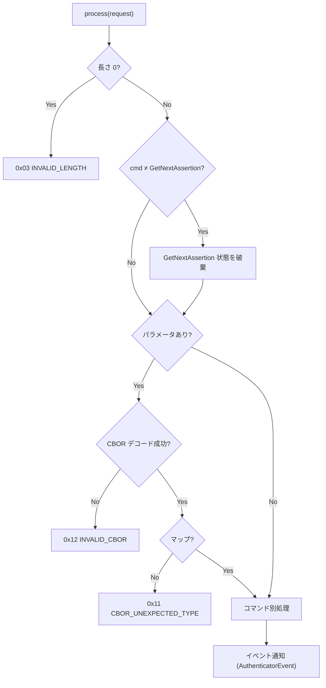
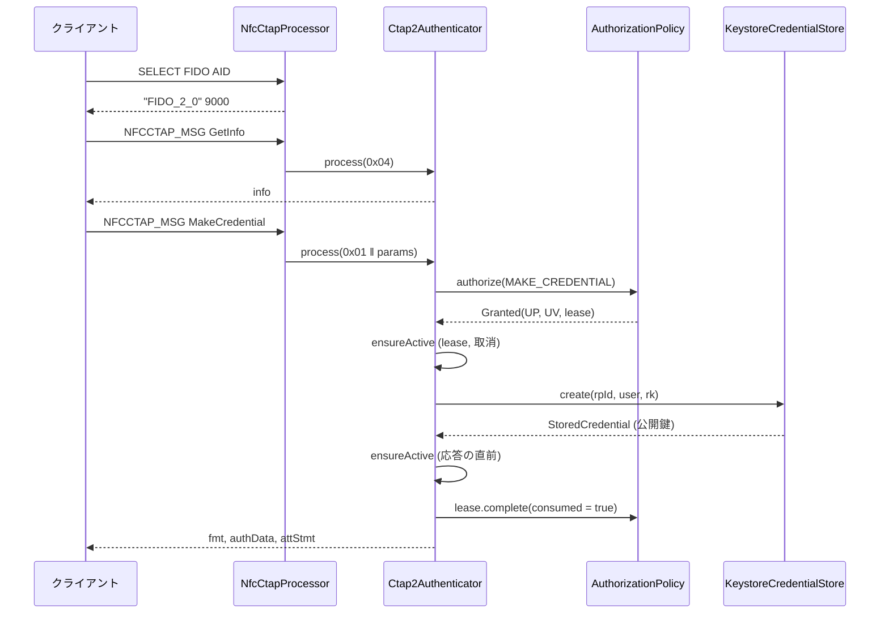
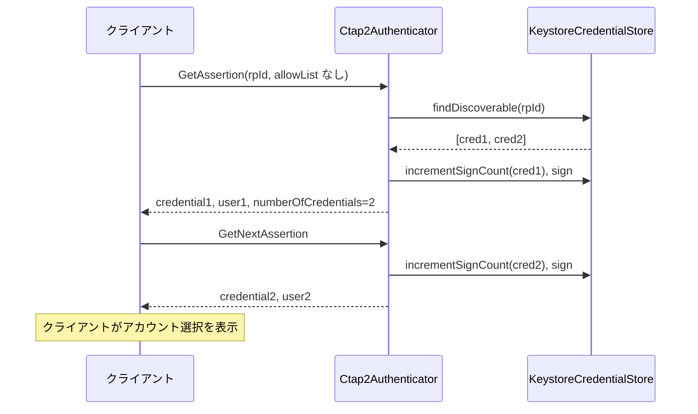

# DD-01 CTAP2 プロトコル

| 項目 | 内容 |
|---|---|
| 文書番号 | TCSKE-DD-01 |
| 版数 | 1.7 |
| 作成日 | 2026-11-02 |
| 改訂 | 1.7 (2026-11-05): 上書き登録でクレデンシャルのタイトル (FR-27) を引き継ぐ (§3.2 手順 9・13) |
| 改訂 | 1.6 (2026-11-05): コードレビュー (2026-11-05) の指摘への対応。トークンを全トランスポートで失効 (§12.1)、credentialManagement の認証対象を受信バイト列に (§12.4)、getPINRetries の pinUvAuthProtocol を省略可 (§11.1、§13.2)、Protocol 1 の長いパディング (§13.4)、上書き登録の作成日時 (§3.2)、getUVRetries の不採用の理由 (§13.5) |
| 改訂 | 1.5 (2026-11-05): clientPIN (PIN の設定・変更・照合、PIN によるトークンの発行) を追加 (§2、§3.3、§6、§8、§11.1、§12.5、§13) |
| 改訂 | 1.4 (2026-11-05): CTAP 2.1 (pinUvAuthToken、credProtect、authenticatorCredentialManagement) を追加 (§1、§2、§3、§4、§6、§8、§11.1、§12) |
| 改訂 | 1.3 (2026-11-05): hmac-secret 拡張と authenticatorClientPIN の getKeyAgreement を追加 (§2、§3、§4、§7、§8、§11) |
| 改訂 | 1.2 (2026-11-05): PIN/UV Auth Protocol 1 / 2 の暗号処理 (§10) を追加 (コマンドからはまだ使わない) |
| 改訂 | 1.1 (2026-11-02): 外部レビュー対応 (認可の Lease 化、入力検証・処理順序・UP/UV・allowList・GetNextAssertion・上書き登録・CBOR の厳密化)。`review/FIX_PLAN.md` |
| 実装 | `fido-core/.../ctap2/Ctap2Authenticator.kt`, `CtapConstants.kt`, `cbor/Cbor.kt`, `ctap2/ClientPin.kt`, `ctap2/HmacSecret.kt`, `ctap2/CredProtect.kt`, `ctap2/CredentialManagement.kt`, `ctap2/PinStore.kt`, `pin/PinUvAuthProtocol.kt`, `pin/CoseEcdhKey.kt`, `pin/Hkdf.kt` |
| 関連要件 | FR-04〜FR-06, FR-10, FR-16, FR-21〜FR-25, SEC-10 |

## 1. 共通仕様

### 1.1 メッセージ形式

| 方向 | 形式 |
|---|---|
| 要求 | `コマンド (1 バイト) ‖ CBOR マップ (任意)` |
| 応答 | `ステータス (1 バイト) ‖ CBOR マップ (成功時のみ、任意)` |

### 1.2 CBOR

- エンコードは CTAP2 canonical 形式: 整数は最短表現、マップのキーは「メジャータイプ → エンコード長 → バイト列の辞書順」で整列、重複キーはエラー。
- デコードで受け付ける型: 整数 (`Long`)、バイト列、テキスト、配列、マップ (キーは整数またはテキスト)、真偽値、null、浮動小数点。
- 拒否する入力: 不定長、最短でない整数・長さの表現 (例 `18 01`)、タグ、不正な UTF-8、データ長を超える長さ宣言、
  ネスト 16 段超、末尾の余剰バイト、マップキーの重複・不正型。
- マップキーの並び順は検証しない (CTAP 2.0 §6 ではデコーダの検証は推奨であり、クライアントとの互換性を優先する)。

### 1.3 共通処理

- 未知のコマンド・非対応コマンド (CTAP 2.1 の試行版の CredentialManagement 0x41、authenticatorLargeBlobs 0x0C、authenticatorConfig 0x0D 等) は
  `0x01 INVALID_COMMAND`。ClientPIN (0x06) は §11.1、CredentialManagement (0x0A) は §12.4。
- 処理中の `CtapException` はそのステータス、その他の例外 (`IOException`・`KeyStoreException` 等を含むすべて) は
  `0x7F ERR_OTHER` を返し、トランスポートのスレッドへ例外を漏らさない。
- `process(request, keepAlive, channel)` の `keepAlive` はその要求専用の取消トークン、`channel` は受信チャネル
  (CTAPHID の CID。NFC は 0) で、GetNextAssertion の対応付けに使う。
- すべてのコマンドで、結果 (コマンド・ステータス・RP ID・ユーザー名・詳細) を `AuthenticatorEventListener` に通知する。

### 1.4 認可 (AuthorizationPolicy)

ユーザー操作を伴う処理は `AuthorizationPolicy.authorize(AuthorizationRequest, KeepAlive)` を呼ぶ。

| 項目 | 内容 |
|---|---|
| 要求内容 | 操作種別 (`MAKE_CREDENTIAL` / `GET_ASSERTION` / `RESET` / `SELECTION` / `PIN_UV_AUTH_TOKEN` / `CREDENTIAL_MANAGEMENT` / `CLIENT_PIN`)、RP ID、ユーザー名、UP 要否、UV 要否 |
| 結果 | `Granted(userPresent, userVerified, lease)` または `Denied(status, reason)` |
| 有効性の確認 | 鍵の生成・署名の直前と応答の直前に `lease.isValid()` と取消トークンを確認 (`ensureActive`)。失効は `0x27`、取消は `0x2D` |
| 完了 | 許可された操作は、すべての経路で `lease.complete(consumed)` を 1 回呼ぶ。`consumed` = 登録・認証の成功で、UP または `uv` オプションによる UV を伴う (ワンタイム消費)。トークンの発行 (§12.1、§13.2)・資格情報の管理 (§12.4)・PIN の設定と変更 (§13.2) は消費しない |

Android 実装の判定内容と Lease の寿命は DD-05 §2 を参照。

## 2. authenticatorGetInfo (0x04)

パラメータなし。認可不要。

| キー | 名前 | 値 |
|---|---|---|
| 0x01 | versions | `["FIDO_2_0", "FIDO_2_1"]` (§12.5) |
| 0x02 | extensions | `["credProtect", "hmac-secret"]` (§12.3、§11.2) |
| 0x03 | aaguid | `523283ca3c2c48b58bffa722f900e190` (16 バイト) |
| 0x04 | options | `{"rk": true, "up": true, "uv": true, "plat": false, "clientPin": <PIN 設定済みか>, "pinUvAuthToken": true, "credMgmt": true, "makeCredUvNotRqd": true}` |
| 0x05 | maxMsgSize | 2048 |
| 0x06 | pinUvAuthProtocols | `[2, 1]` (§10) |
| 0x09 | transports | NFC: `["nfc"]`、Bluetooth HID: `["usb"]` (§2.1) |
| 0x0A | algorithms | `[{"alg": -7, "type": "public-key"}]` |
| 0x0D | minPINLength | 4 (§13.4) |

- `clientPin`: PIN が未設定なら false、設定済みなら true。PIN の保存データを読み込めない場合も true とする (PIN を使わない経路で迂回させない。§13.1)。
  ユーザー検証は内蔵 UV (`uv: true`) と PIN の両方を使える。CTAP 2.1 のクライアントは内蔵 UV または PIN で pinUvAuthToken を得る (§12.1、§13.2)。
- `makeCredUvNotRqd: true`: 本アプリはすべての登録で受付ゲートの本人確認を経るため、UV の指定を必須にしない (§12.5)。
- 0x07 (maxCredentialCountInList)・0x08 (maxCredentialIdLength) 等の任意項目は含めない (allowList の件数・ID の長さを制限しない)。
  対応しない PIN プロトコルを広告してクライアントの制約を回避することはしない (BD-04 §5 の注記を参照)。

### 2.1 Bluetooth HID の transports を `usb` とする理由

外部レビュー (F-14) で「Bluetooth 接続なのに `usb`」と指摘されたが、変更しない。

- Bluetooth Classic HID の上で CTAPHID をそのまま使っており、ホスト OS・クライアントからは HID の FIDO デバイスとして見える。
  クライアントは HID デバイスを USB HID の transport として扱う (Chromium の `kUsbHumanInterfaceDevice` 等)。
- `ble` は FIDO の BLE トランスポート (GATT) を意味するため、本アプリの Bluetooth HID には当てはまらない。
- transports は任意項目で、クライアントが credential の transport ヒントに使う程度であり、実害は小さい。

## 3. authenticatorMakeCredential (0x01)

### 3.1 パラメータ

| キー | 名前 | 型 | 必須 | 扱い |
|---|---|---|---|---|
| 0x01 | clientDataHash | bytes | ○ | 32 バイト (SHA-256)。自己アテステーションの署名対象 |
| 0x02 | rp | map | ○ | `id` (必須・text)、`name` (任意) |
| 0x03 | user | map | ○ | `id` (必須・1〜64 バイト)、`name`、`displayName` |
| 0x04 | pubKeyCredParams | array | ○ | `{"type": "public-key", "alg": -7}` が含まれること |
| 0x05 | excludeList | array | | `type` = `public-key` の `id` を照合 |
| 0x06 | extensions | map | | `hmac-secret` (真偽値。§11.2)、`credProtect` (1〜3。§12.3)。未知の拡張は無視 |
| 0x07 | options | map | | `rk` (既定 false)、`uv` (既定 false)、`up` (false は不可、true は互換性のため許容) |
| 0x08 | pinUvAuthParam (2.0 の pinAuth) | bytes | | §3.3 |
| 0x09 | pinUvAuthProtocol (2.0 の pinProtocol) | uint | | pinUvAuthParam がある場合に使う (§3.3) |

### 3.2 処理順序

| # | 処理 | エラー |
|---|---|---|
| 1 | 必須パラメータの存在・型を確認。clientDataHash が 32 バイトでない | 欠落 `0x14 MISSING_PARAMETER`、型不正 `0x11`、長さ不正 `0x03 INVALID_LENGTH` |
| 2 | `rp.id`、`user.id` を取得。`user.id` が 0 バイトまたは 65 バイト以上 | `0x02 INVALID_PARAMETER` |
| 3 | pubKeyCredParams・excludeList・extensions・options・pinAuth・pinProtocol の型を確認 | `0x11` / `0x14` |
| 4 | excludeList に同一 RP の登録済み ID があれば、認可 (存在確認) 後に拒否 (CTAP 2.0 §5.1 手順 1)。credProtect レベル 3 の credential は、認可が UV 済みの場合のみ一致として扱う (CTAP 2.1 §6.1.2 手順 12) | `0x19 CREDENTIAL_EXCLUDED` |
| 5 | pubKeyCredParams に `public-key` / ES256 がない | `0x26 UNSUPPORTED_ALGORITHM` |
| 6 | options の `up: false` | `0x2C INVALID_OPTION` |
| 7 | pinUvAuthParam の確認 (§3.3。トークンは mc 権限) | `0x35` / `0x33` / `0x14` / `0x02` |
| 8 | 認可 (UP 必須、UV = options.uv) | `Denied` のステータス |
| 9 | 有効性の確認 → 鍵ペア生成・メタデータ保存 (`CredentialStore.create`)。`hmac-secret: true` なら CredRandom も作る。`rk: true` なら、同一 RP・同一 `user.id` の discoverable credential のうち最も新しいもののタイトル (`label`、DD-06 §2) を新しい credential に付ける (読み込めない場合は付けない) | 失効 `0x27`、生成失敗 `0x27 OPERATION_DENIED` |
| 10 | authenticatorData (§7) を作成。フラグ UP・AT、認可で UV 済みまたは pinUvAuthParam を検証済みなら UV。要求された拡張 (`credProtect`・`hmac-secret`) の出力があれば ED と拡張 | |
| 11 | 有効性の確認 → アテステーション作成 (§3.4) | 署名不可 `0x27` |
| 12 | 有効性の確認 (応答の直前) | 失効 `0x27` |
| 13 | `rk: true` なら、同一 RP・同一 `user.id` で新しい credential より前に作成された discoverable credential を削除 (上書き登録。タイトルは手順 9 で引き継ぎ済み)。作成日時はストアが既存のどの credential より大きくする (時計の巻き戻しの影響を受けない)。作成日時で絞るのは、同時に進んだ 2 つの上書き登録で、先に完了した側が後から作られた credential を消さないため | 削除の失敗は無視 (旧 credential が残るだけ) |
| 13a | pinUvAuthParam を使った場合は、トークンの UV フラグと権限を消す (§12.2) | |
| 14 | `lease.complete(consumed = 成功)`。応答を返さなかった場合は、手順 9 で作成した credential を削除する | |

> 上書き登録では、旧 credential の削除を新しい登録の完成後に行う (手順 13)。鍵生成・保存・アテステーションの
> いずれかが失敗しても、既存の credential は使えるまま残る。

### 3.3 pinUvAuthParam の扱い

| 入力 | 処理 |
|---|---|
| pinUvAuthParam なし | 通常処理 (内蔵 UV は `uv` オプションと受付ゲートで扱う) |
| 長さ 0 (プラットフォームのタッチ待ちプローブ) | 認可 (UP) 後に、PIN が未設定なら `0x35 PIN_NOT_SET`、設定済み (または読み込めない) なら `0x31 PIN_INVALID` (CTAP 2.1 §6.1.2 手順 1。Lease は消費せずに完了する) |
| 長さ 1 以上で pinUvAuthProtocol なし | `0x14 MISSING_PARAMETER` |
| 長さ 1 以上で未対応の pinUvAuthProtocol | `0x02 INVALID_PARAMETER` |
| 長さ 1 以上 | pinUvAuthToken で検証する (§12.2)。失敗は `0x33 PIN_AUTH_INVALID`。成功しても受付ゲートの認可は行う |

GetAssertion (キー 0x06) も同様に扱う。

### 3.4 アテステーション

| 設定 | fmt | attStmt |
|---|---|---|
| なし (既定) | `"none"` | `{}` |
| 自己アテステーション | `"packed"` | `{"alg": -7, "sig": ECDSA(クレデンシャル秘密鍵, authenticatorData ‖ clientDataHash)}` (x5c なし) |

### 3.5 応答

| キー | 名前 | 値 |
|---|---|---|
| 0x01 | fmt | §3.4 |
| 0x02 | authData | §7 (attestedCredentialData を含む) |
| 0x03 | attStmt | §3.4 |

## 4. authenticatorGetAssertion (0x02)

### 4.1 パラメータ

| キー | 名前 | 型 | 必須 | 扱い |
|---|---|---|---|---|
| 0x01 | rpId | text | ○ | |
| 0x02 | clientDataHash | bytes | ○ | 32 バイト (SHA-256)。署名対象 |
| 0x03 | allowList | array | | `type` = `public-key` の `id`。空でなければ、そのリストに限定する |
| 0x04 | extensions | map | | `hmac-secret` (§11.2)。未知の拡張は無視 |
| 0x05 | options | map | | `up` (既定 true)、`uv` (既定 false)、`rk` があれば `0x2C INVALID_OPTION` |
| 0x06 | pinUvAuthParam | bytes | | §3.3 (トークンは ga 権限) |
| 0x07 | pinUvAuthProtocol | uint | | pinUvAuthParam がある場合に使う |

### 4.2 処理順序

| # | 処理 | エラー |
|---|---|---|
| 1 | 必須パラメータ・型の確認 (clientDataHash 32 バイト)、options 解釈 | `0x14` / `0x11` / `0x03` / `0x2C` |
| 1a | hmac-secret の入力があれば、`up: false` を拒否し、入力を検証して salt を復号する (§11.2)。認可の前に行う | `0x2B` / `0x02` / `0x33` 等 |
| 2 | pinUvAuthParam の確認 (§3.3)。検証できた場合、`uv` オプションは無視する (pinUvAuthParam が優先。CTAP 2.1 §6.2) | `0x35` / `0x33` / `0x14` / `0x02` |
| 3 | 認可 (UP = options.up、UV = options.uv)。credential の有無を返す前に行う (認可前の存在確認を防ぐ) | `Denied` のステータス |
| 4 | フラグ決定: UP = `options.up` かつ許可。UV = pinUvAuthParam を検証済み、または (許可で UV 済み かつ (UP または `options.uv`))。`options.uv` なのに UV 未実施なら拒否 | `0x27` |
| 5 | 対象クレデンシャルの決定: allowList が空でなければ「同一 RP かつ ID 一致」(対応 type の ID が 0 件なら 0 件)、allowList なし・空なら「同一 RP の discoverable を作成日時の新しい順」。credProtect で絞る (§12.3) | 0 件 `0x2E NO_CREDENTIALS` |
| 6 | 有効性の確認 → 先頭のクレデンシャルで署名カウンタを +1 し、authenticatorData (37 バイト。hmac-secret の出力があれば ED と拡張を付ける) を作成して署名 → 有効性の確認 | 失効・署名不可 `0x27` |
| 7 | allowList なし・空で 2 件以上なら `numberOfCredentials` を付け、残りを GetNextAssertion 用に保持 (Lease・取消トークン・チャネルも保持) | |
| 8 | UP を伴う認証に pinUvAuthParam を使った場合は、トークンの UV フラグと権限を消す (§12.2)。`lease.complete(consumed = 成功 かつ (UP または `uv` オプションによる UV))`。silent assertion (`up: false`) は、pinUvAuthParam の有無にかかわらずワンタイムを消費しない | |

| options | flags | ワンタイム |
|---|---|---|
| `up: true` (既定)、`uv` 任意 | UP・UV | 消費 |
| `up: false, uv: true` | UV | 消費 |
| `up: false, uv: false` (silent) | なし | 消費しない |
| `up: false` + pinUvAuthParam | UV | 消費しない |
| `up: true` + pinUvAuthParam | UP・UV | 消費 |

### 4.3 応答

| キー | 名前 | 値 |
|---|---|---|
| 0x01 | credential | `{"id": <credentialId>, "type": "public-key"}` |
| 0x02 | authData | rpIdHash ‖ flags ‖ signCount (‖ 拡張。§11.2) |
| 0x03 | signature | ECDSA (DER) over `authData ‖ clientDataHash` |
| 0x04 | user | discoverable credential の場合のみ。`{"id"}`、UV 済みなら `name` / `displayName` も含める |
| 0x05 | numberOfCredentials | allowList なしで 2 件以上の場合のみ |

## 5. authenticatorGetNextAssertion (0x08)

| 条件 | 結果 |
|---|---|
| 直前のコマンドが GetAssertion で、残りがあり、継続が有効 | 次のクレデンシャルの応答 (§4.3 の 0x01〜0x04)。フラグは最初の GetAssertion と同じ |
| 状態なし / 他のコマンドを挟んだ / 直前の成功から 30 秒経過 / 残りなし | `0x30 NOT_ALLOWED` |
| 別のチャネル (CID) から / 元の要求の取消・切断後 / 受付の明示的な停止・前面離脱後 | `0x30 NOT_ALLOWED` (状態を破棄) |

- 認可は再度行わず、元の GetAssertion の Lease で継続する。ワンタイムの消費後も継続できる (DD-05 §2.4)。
- 30 秒のタイマーは単調時計で計り、成功の都度リセットする (CTAP 2.0 §5.3)。
- 次の位置への移動は署名に成功してから行う (署名に失敗しても、同じクレデンシャルを再度取得できる)。
- 署名カウンタはクレデンシャル毎に +1 する。
- hmac-secret の入力があった場合は、元の GetAssertion で復号した salt と共有鍵で、各クレデンシャルの出力を作る。

## 6. authenticatorReset (0x07) / authenticatorSelection (0x0B)

| コマンド | 処理 |
|---|---|
| Reset | 設定「PC からのリセットを許可」が OFF なら認可前に `0x27 OPERATION_DENIED`。ON なら認可 (UP・UV) 後に全クレデンシャルと PIN を削除し、鍵交換の鍵と pinUvAuthToken を作り直して `0x00` |
| Selection | 認可 (UP) 後に `0x00`。ワンタイムは消費しない (`complete(false)`) |

## 7. authenticatorData

| オフセット | 長さ | 内容 |
|---|---|---|
| 0 | 32 | rpIdHash = SHA-256(rpId の UTF-8) |
| 32 | 1 | flags: bit0 UP、bit2 UV、bit6 AT (登録時)、bit7 ED (拡張あり) |
| 33 | 4 | signCount (ビッグエンディアン) |
| 37 | 16 | (登録時) AAGUID |
| 53 | 2 | (登録時) credentialId 長 L (= 32) |
| 55 | L | (登録時) credentialId |
| 55+L | 77 | (登録時) 公開鍵 COSE_Key `{1: 2 (EC2), 3: -7 (ES256), -1: 1 (P-256), -2: x (32), -3: y (32)}` |
| 末尾 | 可変 | (ED のとき) 拡張の CBOR マップ (§11.2) |

## 8. ステータスコード一覧 (使用するもの)

| 値 | 名前 | 主な発生箇所 |
|---|---|---|
| 0x00 | OK | 成功 |
| 0x01 | INVALID_COMMAND | 未対応コマンド |
| 0x02 | INVALID_PARAMETER | user.id の長さ不正、未対応の pinUvAuthProtocol、鍵交換の公開鍵の不正、salt の復号失敗・長さ不正 (§11) |
| 0x03 | INVALID_LENGTH | 空の要求、clientDataHash が 32 バイトでない |
| 0x11 | CBOR_UNEXPECTED_TYPE | 型不正 |
| 0x12 | INVALID_CBOR | CBOR デコード失敗 |
| 0x14 | MISSING_PARAMETER | 必須パラメータ欠落、pinUvAuthParam に対する pinUvAuthProtocol の欠落 |
| 0x19 | CREDENTIAL_EXCLUDED | excludeList 一致 |
| 0x22 | INVALID_CREDENTIAL | 鍵・メタデータの不整合 |
| 0x26 | UNSUPPORTED_ALGORITHM | ES256 非指定 |
| 0x27 | OPERATION_DENIED | 前面表示外・未確認 (NFC)・他の操作がワンタイムを予約中・認可の失効・鍵生成/署名不可・UV 未実施・リセット不許可 |
| 0x2B | UNSUPPORTED_OPTION | hmac-secret の入力と `up: false` の組み合わせ |
| 0x2C | INVALID_OPTION | `up: false` (登録)、`rk` 指定 (認証) |
| 0x2D | KEEPALIVE_CANCEL | ホストからのキャンセル (Bluetooth)、要求の取消 |
| 0x2E | NO_CREDENTIALS | 該当クレデンシャルなし |
| 0x2F | USER_ACTION_TIMEOUT | 本人確認待ちのタイムアウト (Bluetooth) |
| 0x30 | NOT_ALLOWED | GetNextAssertion・credentialManagement の列挙の続きの状態なし・期限切れ・失効・チャネル不一致 |
| 0x31 | PIN_INVALID | PIN の誤り、PIN 設定済みでの長さ 0 の pinUvAuthParam |
| 0x32 | PIN_BLOCKED | PIN の残りの試行回数が 0 |
| 0x33 | PIN_AUTH_INVALID | pinUvAuthParam の検証失敗・権限の不足・RP ID の不一致・使用中でないトークン、hmac-secret の saltAuth の不一致 |
| 0x34 | PIN_AUTH_BLOCKED | PIN の連続 3 回の誤り (セッションが変わるまで照合しない) |
| 0x35 | PIN_NOT_SET | PIN 未設定での長さ 0 の pinUvAuthParam、PIN の変更・PIN によるトークンの要求 |
| 0x36 | PUAT_REQUIRED | credentialManagement で pinUvAuthParam がない |
| 0x37 | PIN_POLICY_VIOLATION | 新しい PIN が 4 文字未満・63 バイト超・不正な UTF-8 |
| 0x3E | INVALID_SUBCOMMAND | ClientPIN・credentialManagement の未対応のサブコマンド |
| 0x3F | UV_INVALID | トークンの発行で、認可が UV を伴わない |
| 0x40 | UNAUTHORIZED_PERMISSION | 未対応の権限 (be・lbw・acfg) のトークンの要求 |
| 0x7F | OTHER | 想定外の例外、メタデータ・PIN の読み込み・保存の失敗 (DD-07) |

## 9. シーケンス

### 9.1 登録 (NFC、本人確認済み)

### 9.2 パスキーでの認証 (複数アカウント)

## 10. PIN/UV Auth Protocol

CTAP 2.1 §6.5 の PIN/UV Auth Protocol の認証器側を `fido.pin.PinUvAuthProtocol` に実装する。
clientPIN (0x06) の鍵交換、hmac-secret 拡張、pinUvAuthToken の検証で共通に使う。現時点では ClientPIN の getKeyAgreement と hmac-secret (§11) で使う。

### 10.1 共通

| 操作 | 内容 |
|---|---|
| 鍵交換の鍵ペア | P-256 のソフトウェア鍵 (メモリ上のみ)。インスタンスの生成時と `regenerate()` で作り直す |
| `getPublicKey()` | COSE_Key `{1: 2 (EC2), 3: -25, -1: 1 (P-256), -2: x, -3: y}`。alg の -25 は仕様上の固定値 |
| `decapsulate(peerCoseKey)` | 相手の COSE_Key を検証し (§10.4)、ECDH の結果 Z (x 座標、32 バイト) から共有鍵を導出する |
| `verify(key, message, signature)` | `authenticate(key, message)` と `signature` を定数時間で比較する (`MessageDigest.isEqual`)。長さが違えば不一致 |

暗号処理は JCA (`KeyAgreement("ECDH")`、`Cipher("AES/CBC/NoPadding")`、`Mac("HmacSHA256")`) のみを使い、外部ライブラリを追加しない。
入力の不正は `PinUvAuthProtocolException` とし、呼び出し側が CTAP のステータスに変換する。インスタンスはスレッドセーフではない
(`Ctap2Authenticator.process` が直列化する)。

### 10.2 Protocol 1

| 項目 | 内容 |
|---|---|
| 共有鍵 | SHA-256(Z) (32 バイト) |
| encrypt / decrypt | AES-256-CBC、IV はすべて 0。平文・暗号文は空でない 16 バイトの倍数 |
| authenticate | HMAC-SHA-256(key, message) の先頭 16 バイト。key は共有鍵または pinUvAuthToken (16 / 32 バイト) |

### 10.3 Protocol 2

| 項目 | 内容 |
|---|---|
| 共有鍵 | HMAC 鍵 ‖ AES 鍵 (計 64 バイト)。各 32 バイトを HKDF-SHA-256 (salt = 32 バイトの 0、info = `"CTAP2 HMAC key"` / `"CTAP2 AES key"`) で導出 |
| encrypt | AES-256-CBC (AES 鍵)。ランダムな IV (16 バイト) を暗号文の先頭に付ける |
| decrypt | 先頭 16 バイトを IV とする。IV を除いた部分が空でない 16 バイトの倍数でなければ不正 |
| authenticate | HMAC-SHA-256 (32 バイト)。key が共有鍵 (64 バイト) なら先頭の HMAC 鍵、pinUvAuthToken (32 バイト) ならそのまま使う |

HKDF は `fido.pin.Hkdf` (RFC 5869) で実装し、RFC 5869 付録 A のテストベクタで確認する (DD-10 UT-112)。

### 10.4 相手の公開鍵の検証

| 条件 | 不正の例 |
|---|---|
| kty = 2 (EC2)、crv = 1 (P-256) | OKP、P-384 |
| alg は省略可。指定されていれば -25 | -7 |
| x・y が 32 バイトのバイト列 | 31 バイト、テキスト |
| x・y が体の範囲内 (0 ≤ x, y < p) で、y² = x³ − 3x + b (mod p) を満たす | 曲線外の点 (無効曲線攻撃の防止) |

## 11. ClientPIN の鍵交換と hmac-secret 拡張

### 11.1 authenticatorClientPIN (0x06)

対応するサブコマンドは getPINRetries (0x01)、getKeyAgreement (0x02)、setPIN (0x03)、changePIN (0x04)、getPinToken (0x05)、
getPinUvAuthTokenUsingUvWithPermissions (0x06。§12.1)、getPinUvAuthTokenUsingPinWithPermissions (0x09)。PIN に関するものは §13。
getUVRetries (0x07) など、その他のサブコマンドは `0x3E INVALID_SUBCOMMAND` (getUVRetries を対応しない理由は §13.5)。

| キー | 名前 | 型 | 必須 | 扱い |
|---|---|---|---|---|
| 0x01 | pinUvAuthProtocol | uint | ○ (getPINRetries では省略可。CTAP 2.1 §6.5.5) | 1 または 2。それ以外は `0x02 INVALID_PARAMETER` |
| 0x02 | subCommand | uint | ○ | |

getKeyAgreement の応答: `{1: keyAgreement}` (§10.1 の COSE_Key)。認可は不要 (鍵交換の公開鍵を返すだけで、鍵や credential を使わない)。
鍵交換の鍵はプロトコルごと・`Ctap2Authenticator` のインスタンス (トランスポート) ごとに持ち、インスタンスの生成時と Reset で作り直す。

### 11.2 hmac-secret

credential ごとに 32 バイトの秘密値 CredRandom を 2 つ (UV あり用・UV なし用) 持ち、プラットフォームが送る salt に対して
`HMAC-SHA-256(CredRandom, salt)` を返す (CTAP 2.1 §12.5)。WebAuthn の PRF 拡張はこの拡張で実現される。
CredRandom の保管は DD-07 §6。

**MakeCredential**

| 入力 | 処理 | 出力 (authData の拡張、ED) |
|---|---|---|
| `"hmac-secret": true` | CredRandom を作る (`CredentialOptions(hmacSecret = true)`)。作れなければ登録全体を `0x27` で失敗させる | `{"hmac-secret": true}` |
| `"hmac-secret": false`、なし | 作らない | なし |
| 真偽値以外 | `0x11 CBOR_UNEXPECTED_TYPE` | — |

**GetAssertion の入力** (`"hmac-secret": {1: keyAgreement, 2: saltEnc, 3: saltAuth, 4: pinUvAuthProtocol}`)

| # | 処理 | エラー |
|---|---|---|
| 1 | `up: false` との組み合わせを拒否する | `0x2B UNSUPPORTED_OPTION` |
| 2 | 入力が map で、1〜3 があり型が正しいこと。4 は省略可 (省略時は Protocol 1) | 欠落 `0x14`、型不正 `0x11` |
| 3 | プロトコルの選択 | 未対応 `0x02`。省略で Protocol 1 に未対応なら `0x33` |
| 4 | `decapsulate(keyAgreement)` で共有鍵を導出 (§10.4 の検証を含む) | `0x02 INVALID_PARAMETER` |
| 5 | `verify(共有鍵, saltEnc, saltAuth)` | `0x33 PIN_AUTH_INVALID` |
| 6 | saltEnc を復号し、32 バイト (salt1) または 64 バイト (salt1 ‖ salt2) であること | `0x02 INVALID_PARAMETER` |

手順 1〜6 は認可の前に行う (不正な入力でワンタイムの受付を使わない。credential の有無には依存しない)。

**GetAssertion の出力** (各 credential の応答ごと)

- 応答の UV フラグが立っていれば CredRandomWithUV、立っていなければ CredRandomWithoutUV を使う。
- `encrypt(共有鍵, HMAC(CredRandom, salt1) [‖ HMAC(CredRandom, salt2)])` を authData の拡張 `{"hmac-secret": <暗号文>}` とし、ED を立てる。
  署名は拡張を含む authData に対して行う。
- CredRandom のない credential (hmac-secret なしで登録) では拡張を無視し、出力を付けない。
- CredRandom を取得できない (Keystore の認証期限切れ等) 場合は `0x27 OPERATION_DENIED`。
- GetNextAssertion でも、元の GetAssertion の salt と共有鍵で同様に出力を作る。

## 12. CTAP 2.1

### 12.1 pinUvAuthToken (内蔵 UV による発行)

`ClientPin` が pinUvAuthToken (32 バイトの乱数) とその状態を持つ (CTAP 2.1 §6.5.2.1)。トークンはプロトコルごとに持ち、
新しいトークンの発行・Reset ですべて作り直す。

| 状態 | 内容 |
|---|---|
| 使用中 | 発行で開始。次の場合に終了する: 発行から 19 秒以内に一度も使われない (NFC の既定の上限 19.8 秒以下)、発行から 600 秒が経過、発行時の Lease の失効 (受付の停止・前面離脱)、トランスポートのセッションの変化 (`resetSession`。NFC の切断など)、新しいトークンの発行、Reset、共有の `PinStore` の版 (`revision`) の変化 (いずれかのトランスポートでの Reset・PIN の設定と変更、アプリでの全削除・PIN の消去。トークンはトランスポートごとに持つため、版で全トランスポートのトークンを失効させる) |
| 権限 | mc (0x01)、ga (0x02)、cm (0x04)。未定義のビットは無視する |
| 権限の RP ID | 発行時に指定された RP ID。指定がなければ最初の登録・認証で結び付ける |
| UV フラグ | 発行時に立て、UP を伴う登録・認証で使った後に消す |

UP のフラグは持たない (登録・認証は毎回受付ゲートで UP を得るため)。

**getPinUvAuthTokenUsingUvWithPermissions (ClientPIN 0x06)**

| キー | 名前 | 型 | 必須 |
|---|---|---|---|
| 0x01 | pinUvAuthProtocol | uint | ○ |
| 0x03 | keyAgreement | COSE_Key | ○ |
| 0x09 | permissions | uint | ○ |
| 0x0A | rpId | text | |

| # | 処理 | エラー |
|---|---|---|
| 1 | 必須パラメータ・型の確認、プロトコルの選択 | `0x14` / `0x11` / `0x02` |
| 2 | permissions が 0 | `0x02 INVALID_PARAMETER` |
| 3 | 未対応の権限 (be 0x08、lbw 0x10、acfg 0x20) を含む | `0x40 UNAUTHORIZED_PERMISSION` |
| 4 | `decapsulate(keyAgreement)` で共有鍵を導出 | `0x02` |
| 5 | 内蔵 UV = 受付ゲートの認可 (`PIN_UV_AUTH_TOKEN`、UV 要)。NFC は受付外なら即時に拒否、Bluetooth は本人確認を待つ | `Denied` のステータス。UV を伴わない許可は `0x3F UV_INVALID` |
| 6 | すべてのトークンを作り直し、使用を開始する (Lease を保持)。権限・RP ID を設定する | |
| 7 | `lease.complete(consumed = false)` (ワンタイムは消費しない) | |

応答: `{2: encrypt(共有鍵, pinUvAuthToken)}`。手順 1〜4 は認可の前に行う。

### 12.2 MakeCredential / GetAssertion での使用

pinUvAuthParam (= `authenticate(pinUvAuthToken, clientDataHash)`) を次の順に検証する (CTAP 2.1 §6.1.2 手順 11.1、§6.2.2 手順 6.1)。
いずれかに当たれば `0x33 PIN_AUTH_INVALID`。

1. トークンが使用中であり、HMAC が一致する (プロトコルは要求の pinUvAuthProtocol)
2. 権限 (登録は mc、認証は ga) がある
3. 権限の RP ID が設定されていれば、要求の RP ID と一致する
4. トークンの UV フラグが立っている

成功した場合は、権限の RP ID が未設定なら要求の RP ID を結び付け、応答の UV フラグを立てる。そのうえで **受付ゲートの認可を必ず行う**
(トークンがあっても、前面表示中かつ受付中でなければ登録・認証しない。AGENTS.md §5.1)。
UP を伴う登録・認証に使った後は、トークンの UV フラグと権限 (lbw 以外。本アプリは lbw に対応しないため全権限) を消す (同 §6.1.2 手順 14.4)。
silent assertion (`up: false`) に使った場合は消さない。

### 12.3 credProtect

| レベル | 名前 | GetAssertion で使える条件 |
|---|---|---|
| 1 (既定) | userVerificationOptional | 常に |
| 2 | userVerificationOptionalWithCredentialIDList | 応答の UV フラグが立つ、または allowList で指定された |
| 3 | userVerificationRequired | 応答の UV フラグが立つ |

- MakeCredential の `"credProtect": <1〜3>` を保存し (DD-06 §2)、拡張の出力 `{"credProtect": <レベル>}` を返す。指定がなければレベル 1 で、出力しない。
  1〜3 以外は `0x02`、整数でなければ `0x11`。
- GetAssertion では、対象の credential を決めた後に上の条件で絞る (CTAP 2.1 §6.2.2 手順 7.4・7.5)。残りが 0 件なら `0x2E`。
- excludeList はレベル 3 の credential を、認可が UV 済みの場合のみ一致として扱う (§3.2 手順 4)。
- credentialManagement の列挙では絞らず、レベルを返す (§12.4)。

### 12.4 authenticatorCredentialManagement (0x0A)

discoverable credential の件数の取得・列挙・削除・ユーザー情報の更新を行う (CTAP 2.1 §6.8)。non-discoverable credential は対象外。

| キー | 名前 | 型 |
|---|---|---|
| 0x01 | subCommand | uint |
| 0x02 | subCommandParams | map (`{1: rpIDHash, 2: credentialID, 3: user}`) |
| 0x03 | pinUvAuthProtocol | uint |
| 0x04 | pinUvAuthParam | bytes |

認証対象の subCommandParams は、受信したバイト列そのもの (`Cbor.rawMapValues`) を使う。デコードした値を再エンコードすると、
canonical でない CBOR (キー順序の違い等) を送るクライアントの署名と一致しないため。

| サブコマンド | 認証対象 (pinUvAuthParam) | 権限の RP ID | 応答 |
|---|---|---|---|
| getCredsMetadata (0x01) | `0x01` | なしのみ | `{1: 件数, 2: 残りの見積もり (1000 − 件数)}` |
| enumerateRPsBegin (0x02) | `0x02` | なしのみ | `{3: rp, 4: rpIDHash, 5: totalRPs}` (RP ID の昇順) |
| enumerateRPsGetNextRP (0x03) | — (続き) | — | `{3: rp, 4: rpIDHash}` |
| enumerateCredentialsBegin (0x04) | `0x04 ‖ subCommandParams` | なし、または rpIDHash と一致 | `{6: user, 7: credentialID, 8: publicKey, 9: totalCredentials, 10: credProtect}` (作成日時の新しい順) |
| enumerateCredentialsGetNextCredential (0x05) | — (続き) | — | 上と同じ (9 を除く) |
| deleteCredential (0x06) | `0x06 ‖ subCommandParams` | なし、または credential の RP と一致 | なし |
| updateUserInformation (0x07) | `0x07 ‖ subCommandParams` | なし、または credential の RP と一致 | なし。name・displayName を置き換える (指定がなければ削除)。user.id が異なれば `0x02` |

| 条件 | ステータス |
|---|---|
| pinUvAuthParam がない | `0x36 PUAT_REQUIRED` |
| pinUvAuthProtocol がない / 未対応 | `0x14` / `0x02` |
| 検証の失敗、cm 権限がない、権限の RP ID の条件に合わない | `0x33 PIN_AUTH_INVALID` |
| 対象がない (credential が 0 件、該当する credential がない) | `0x2E NO_CREDENTIALS` |
| 続きの状態がない・種類が違う・30 秒経過・開始時の Lease の失効・セッションの変化・トークンの使用終了 | `0x30 NOT_ALLOWED` |
| 未対応のサブコマンド | `0x3E` |

- 認証付きのサブコマンドは、検証の後に受付ゲートの認可 (`CREDENTIAL_MANAGEMENT`) を得る。ワンタイムは消費しない。UP は求めない。
- 列挙の続きは認可を再度行わず、開始時の Lease とトークンが有効な間だけ受け付ける。credentialManagement 以外のコマンドを受信すると、列挙の途中状態を破棄する。
- 削除・更新は `CredentialStore.delete` / `updateUser` で行う (DD-07 §5)。

### 12.5 CTAP 2.0 との共存と設計判断

`versions` に `FIDO_2_0` と `FIDO_2_1` を並べ、両方のクライアントに対応する。2.1 の追加は新しいコマンド・サブコマンド・オプション・
GetInfo の項目であり、2.0 のクライアントは知らない項目を無視して従来どおり動く。

| 項目 | 内容 |
|---|---|
| 2.0 のクライアント | `uv` オプション (内蔵 UV) で登録・認証する。hmac-secret の鍵交換は Protocol 1 |
| 2.1 のクライアント | 内蔵 UV で pinUvAuthToken を得て pinUvAuthParam を付ける (§12.1、§12.2)。Protocol 2 を優先する |
| NFC の SELECT の応答 | `FIDO_2_0` のまま (2.1 でも同じ値) |
| FIDO_2_1 の必須要件 (CTAP 2.1 §9) | hmac-secret、`uv` (rk に対して)、`credMgmt`、credProtect、`pinUvAuthToken`、Protocol 2 を満たす |
| `makeCredUvNotRqd: true` | すべての登録で受付ゲートの本人確認を経るため、UV の指定を必須にせず `0x36 PUAT_REQUIRED` を返さない |
| MakeCredential の `up: true` | 2.1 で許容されているため受け付ける (外部レビューの F-07 で不採用とした拒否と整合する) |
| 対象外 | authenticatorConfig (setMinPINLength・alwaysUv 等)、getUVRetries、forcePINChange、largeBlobs、enterprise attestation、NFC の待機 (AP-C F-04)、試行版 (`FIDO_2_1_PRE`、0x41) |

## 13. clientPIN

### 13.1 PIN の保存 (PinStore)

PIN そのものは保存せず、`LEFT(SHA-256(PIN), 16)` と残りの試行回数 (最大 8) を `PinStore` に保存する (Android 実装は DD-07 §7)。
`PinStore` は全トランスポートで 1 つを共有する。

| 状態 | GetInfo の clientPin | PIN の操作 |
|---|---|---|
| NOT_SET | false | setPIN のみ可。changePIN・PIN によるトークンは `0x35 PIN_NOT_SET` |
| SET | true | setPIN は `0x33`。その他は可 (残り 0 回なら `0x32 PIN_BLOCKED`) |
| UNAVAILABLE (保存データを読み込めない) | true | すべて `0x7F` (空として扱わず、上書きしない)。アプリの「PIN を消去」で初期化できる |

照合 (`PinStore.check`) は「残りの試行回数を 1 減らして保存 → 比較 → 一致すれば最大に戻す」を 1 つのロックで行う。
保存できなければ比較しない (回数を減らさずに試行させない)。

### 13.2 サブコマンド

| サブコマンド | パラメータ (キー) | 処理 | 応答 |
|---|---|---|---|
| getPINRetries (0x01) | 1 (省略可) | 残りの試行回数と、連続 3 回の誤りでセッションの変更が必要か | `{3: pinRetries, 4: powerCycleState}` |
| setPIN (0x03) | 1, 3 keyAgreement, 4 pinUvAuthParam, 5 newPinEnc | 未設定であること → 共有鍵 → `verify(共有鍵, newPinEnc, pinUvAuthParam)` → 新しい PIN の復号と検査 (§13.4) → 認可 (`CLIENT_PIN`) → 保存 | なし |
| changePIN (0x04) | 1, 3, 4, 5, 6 pinHashEnc | 設定済み・残り 1 回以上 → 共有鍵 → `verify(共有鍵, newPinEnc ‖ pinHashEnc, pinUvAuthParam)` → 認可 (`CLIENT_PIN`) → 照合 (§13.3) → 新しい PIN の復号と検査 → 保存 → トークンをすべて作り直す | なし |
| getPinToken (0x05。2.0 用) | 1, 3, 6 | permissions・rpId があれば `0x02`。照合の前提は changePIN と同じ → 認可 (`PIN_UV_AUTH_TOKEN`) → 照合 → トークンの発行 (権限 mc・ga) | `{2: encrypt(共有鍵, token)}` |
| getPinUvAuthTokenUsingPinWithPermissions (0x09) | 1, 3, 6, 9 permissions, 10 rpId | permissions の検査 (§12.1 と同じ) → 照合の前提 → 認可 (`PIN_UV_AUTH_TOKEN`) → 照合 → トークンの発行 (指定の権限・RP ID) | `{2: encrypt(共有鍵, token)}` |

- pinUvAuthParam の不一致は `0x33`、パラメータの欠落は `0x14`、型の不正は `0x11`、未対応のプロトコル・鍵交換の公開鍵の不正・pinHashEnc / newPinEnc の長さの不正は `0x02`。
- 状態を変える操作 (setPIN・changePIN) と PIN によるトークンの発行は、**受付ゲートの認可を得てから** PIN を照合する。
  受付外 (前面表示外・本人確認前) では試行回数を減らさずに拒否するため、受付外の総当たりはできない。ワンタイムは消費しない。
- トークンの扱い (期限・失効・使用後の権限の消去) は §12.1、§12.2 と同じ。PIN によるトークンでも、登録・認証のたびに受付ゲートの認可を得る。

### 13.3 照合と試行回数

| 結果 | 処理 | ステータス |
|---|---|---|
| 一致 | 残りの試行回数を 8 に戻し、連続の誤りを 0 にする | — |
| 不一致 (残り 1 回以上、連続 3 回未満) | 使ったプロトコルの鍵交換の鍵を作り直す | `0x31 PIN_INVALID` |
| 不一致 (連続 3 回目) | 同上。以後、セッションが変わるまで照合しない (回数も減らさない) | `0x34 PIN_AUTH_BLOCKED` |
| 不一致 (残り 0 回) | 同上 | `0x32 PIN_BLOCKED` |
| 残り 0 回の状態での要求 | 照合しない。Reset またはアプリの「PIN を消去」で解除する | `0x32 PIN_BLOCKED` |

連続の誤りの数は認証器のインスタンスごとに持ち、トランスポートのセッションの変化 (`resetSession`。NFC の切断 = 電源の再投入に相当) で 0 に戻す。

### 13.4 新しい PIN の検査

| 項目 | 内容 | エラー |
|---|---|---|
| newPinEnc の復号結果 | Protocol 2 は 64 バイトちょうど (CTAP 2.1 §6.5.5.5)。Protocol 1 は 64 バイト以上 (CTAP 2.0 §5.5.5 の「minimum 64 bytes」に合わせ、2.0 のクライアントの長いパディングも受け付ける) | `0x02` |
| PIN | 末尾の 0x00 を除いたもの | — |
| 長さ | 4 コードポイント以上 (minPINLength)、63 バイト以下 | `0x37 PIN_POLICY_VIOLATION` |
| 文字コード | UTF-8 として正しいこと | `0x37` |

復号した PIN は検査とハッシュの計算の後に消去する。

### 13.5 設計判断

| 項目 | 内容 |
|---|---|
| PIN と内蔵 UV | PIN を設定しても内蔵 UV (受付ゲート) は使える。PIN がブロックされても内蔵 UV は止めない (CTAP 2.1 では両方を止めるが、本アプリの本人確認は端末の生体認証・画面ロックであり、PIN の試行回数で管理しない) |
| PIN 設定済みでの UV の指定なしの要求 | `makeCredUvNotRqd: true` (§12.5) のとおり、`0x36 PUAT_REQUIRED` を返さない (すべての登録で受付ゲートの本人確認を経るため) |
| アプリでの PIN の消去 | 試験の利便のため、登録済みのクレデンシャルを残したまま PIN だけを消せる (本人確認が必要。SEC-09)。アプリの全削除・Reset では PIN も消す |
| getUVRetries (0x07) | 対応しない。CTAP 2.1 では任意 (§9 の必須要件に含まれず、応答の uvRetries も Optional)。本アプリの内蔵 UV は OS の生体認証・画面ロックであり、試行回数を数えられないため、実際と異なる値を返さない |
| 対象外 | forcePINChange、setMinPINLength、noMcGaPermissionsWithClientPin |

