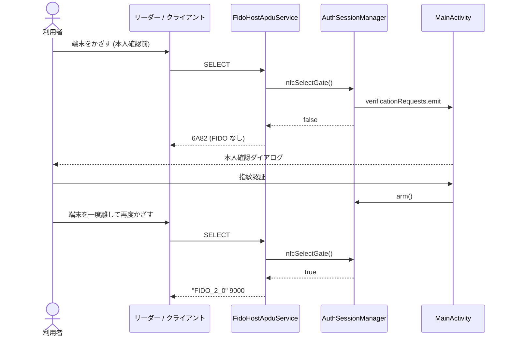

# DD-02 NFC トランスポート

| 項目 | 内容 |
|---|---|
| 文書番号 | TCAK-DD-02 |
| 版数 | 1.0 |
| 作成日 | 2026-11-02 |
| 実装 | `fido-core/.../nfc/NfcCtapProcessor.kt`, `app/.../nfc/FidoHostApduService.kt`, `app/src/main/res/xml/apduservice.xml` |
| 関連要件 | FR-01, FR-14, FR-15, SEC-03, SEC-04 |

## 1. HCE サービスの登録

### 1.1 マニフェスト

| 項目 | 値 |
|---|---|
| サービス | `.nfc.FidoHostApduService` (`exported=true`, `permission=android.permission.BIND_NFC_SERVICE`) |
| intent-filter | `android.nfc.cardemulation.action.HOST_APDU_SERVICE` |
| meta-data | `android.nfc.cardemulation.host_apdu_service` → `@xml/apduservice` |
| 権限 | `android.permission.NFC` |
| uses-feature | `android.hardware.nfc` / `android.hardware.nfc.hce` (いずれも `required=false`) |

### 1.2 apduservice.xml

| 属性 | 値 | 意味 |
|---|---|---|
| `requireDeviceUnlock` | true | 端末ロック中は本サービスへ APDU を渡さない |
| aid-group `category` | `other` | 決済 (payment) の既定アプリ設定と競合しない |
| aid-filter | `A0000006472F0001` | FIDO の AID |

画面オフ時は OS の既定で HCE が動作しない。

### 1.3 優先サービス

`MainActivity.onResume` で `CardEmulation.setPreferredService(activity, FidoHostApduService)` を設定し、
`onPause` で解除する。同じ AID を登録した他アプリがあっても、本アプリ前面表示中は本アプリが選ばれる。

## 2. APDU 仕様

### 2.1 APDU の解析

| 形式 | 解析 |
|---|---|
| Case 1 (4 バイト) | データなし、Le = 0 |
| Case 2 短 (5 バイト) | Le = b4 (0 は 256) |
| Case 3/4 短 | Lc = b4 (1〜255)、Le = 末尾 1 バイト (0 は 256、省略時 0) |
| Case 2 拡張 (7 バイト) | b4 = 0、Le = b5‖b6 (0 は 65536) |
| Case 3/4 拡張 | b4 = 0、Lc = b5‖b6、Le = 末尾 2 バイト (0 は 65536、省略時 0) |
| 不正 (長さ不一致等) | `6700` |

### 2.2 コマンド

| CLA | INS | P1 P2 | 名前 | 処理 |
|---|---|---|---|---|
| 00 | A4 | 04 00 | SELECT | AID = `A0000006472F0001` かつ選択ゲート (§4) 通過で `"FIDO_2_0"` ‖ `9000`。それ以外は `6A82`。状態を初期化する |
| 80 | 10 | 00 00 (P1 は無視) | NFCCTAP_MSG | データを CTAP2 要求として処理 (§3) |
| 90 | 10 | 00 00 | NFCCTAP_MSG (チェイン中) | データを蓄積し `9000` |
| 00 | C0 | 00 00 | GET RESPONSE | 未送信の応答の続き (§3.2) |
| 80 | 11 | — | NFCCTAP_GETRESPONSE | 本実装は処理中 (`9100`) を返さないため `6985` |
| 00 | その他 | — | (U2F 等) | `6D00` |
| その他 | — | — | — | `6E00` |

SELECT 前の SELECT 以外のコマンドは `6A82`。

### 2.3 ステータスワード

| SW | 意味 | 発生条件 |
|---|---|---|
| 9000 | 正常 | |
| 61XX | 続きあり (XX = 残りバイト数、256 以上は 00) | レスポンスチェイニング |
| 6700 | 長さ不正 | APDU 解析失敗、チェイン合計 8192 バイト超、空の CTAP 要求 |
| 6985 | 条件不成立 | 未送信応答がない GET RESPONSE、NFCCTAP_GETRESPONSE |
| 6A82 | ファイルなし | AID 不一致、選択ゲート不通過、SELECT 前のコマンド |
| 6D00 | INS 非対応 | |
| 6E00 | CLA 非対応 | |
| 6F00 | 内部エラー | HCE サービスでの想定外例外 |

## 3. チェイニング

### 3.1 コマンドチェイニング

- CLA の bit 0x10 が立っている間はデータを蓄積し `9000` を返す。bit が立っていない APDU で結合して CTAP2 処理する。
- 合計が 8192 バイトを超えたら蓄積を破棄して `6700`。

### 3.2 レスポンスチェイニング

| 要求 | 1 回の応答の最大データ長 |
|---|---|
| 短い APDU | min(Le, 256) |
| 拡張長 APDU | min(Le, 1024) |

残りがあれば `61XX` を付け、クライアントは `00 C0 00 00 Le` で続きを取得する。
GET RESPONSE 以外のコマンドを受けた時点で未送信の応答は破棄する。

> 拡張長 APDU でも 1024 バイトで区切るのは、NFC コントローラによって長いフレームの扱いに不具合があるため。

## 4. 選択ゲート

SELECT 受信時に `AuthSessionManager.nfcSelectGate()` を呼ぶ。

| 状態 | 結果 | ログ / 動作 |
|---|---|---|
| アプリが前面表示中でない | 拒否 (`6A82`) | WARNING "reader detected but the app is not in the foreground" |
| 前面表示中・本人確認前 (または受付時間切れ) | 拒否 (`6A82`) | WARNING "reader detected before verification"、本人確認ダイアログを要求 (設定 ON 時) |
| 前面表示中・受付時間内 | 受理 (`FIDO_2_0`) | |

SELECT を受理した後でも、CTAP2 処理時に認可 (DD-05 §2.3) を再判定する。

## 5. 未確認時のタップ

## 6. HCE サービスの処理

| メソッド | 処理 |
|---|---|
| `onCreate` | NFC 用の `TransportPolicy` (非ブロッキング)、`Ctap2Authenticator` (transports `["nfc"]`)、`NfcCtapProcessor` を生成 |
| `processCommandApdu` | 単一ワーカースレッド `fido-nfc` に処理を投入して `null` を返す。ワーカーで `NfcCtapProcessor.process` を実行し `sendResponseApdu` で応答。例外時は `6F00` |
| `onDeactivated(reason)` | ワーカーで `NfcCtapProcessor.reset()`、`Ctap2Authenticator.resetSession()`。選択済みだった場合は "reader disconnected (link loss / deselected)" をログ |
| `onDestroy` | ワーカーを停止 |

- APDU は到着順に単一ワーカーで処理されるため順序が保たれる。
- StrongBox の署名は数百 ms かかる場合があるため、メインスレッドでは処理しない。
