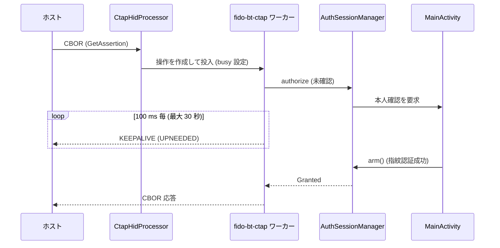

# DD-03 Bluetooth HID トランスポート (実験的)

| 項目 | 内容 |
|---|---|
| 文書番号 | TCAK-DD-03 |
| 版数 | 1.1 |
| 作成日 | 2026-11-02 |
| 改訂 | 1.1 (2026-11-02): 外部レビュー対応 (操作単位の取消トークン、INIT / reset による破棄、例外時の BUSY 解放、LOCK の扱い、登録解除からの復帰、停止処理の非ブロック化)。`review/FIX_PLAN.md` |
| 実装 | `fido-core/.../hid/CtapHidProcessor.kt`, `app/.../bluetooth/BluetoothHidAuthenticator.kt` |
| 関連要件 | FR-02 |

> 本トランスポートは実験的機能であり、ホスト OS / ブラウザ・端末の Bluetooth スタックによっては動作しない。

## 1. HID デバイスの登録

### 1.1 SDP 設定

| 項目 | 値 |
|---|---|
| name / description / provider | `TCAndroidKey` / `FIDO2 security key` / `tecogonaz` |
| subclass | `SUBCLASS1_NONE` |
| QoS | 指定なし (null) |

### 1.2 レポートディスクリプタ

```
06 D0 F1   Usage Page (FIDO Alliance 0xF1D0)
09 01      Usage (CTAPHID)
A1 01      Collection (Application)
09 20        Usage (Input Report Data)
15 00        Logical Minimum (0)
26 FF 00     Logical Maximum (255)
75 08        Report Size (8)
95 40        Report Count (64)
81 02        Input (Data, Var, Abs)
09 21        Usage (Output Report Data)
15 00 26 FF 00 75 08 95 40
91 02        Output (Data, Var, Abs)
C0         End Collection
```

レポート ID は使用しない (入出力とも 64 バイト)。

### 1.3 権限

| 権限 | 用途 |
|---|---|
| `BLUETOOTH_CONNECT` (実行時) | HID Device プロファイルの登録・レポート送受信・ホスト名取得 |
| `BLUETOOTH_ADVERTISE` (実行時) | 検出可能化 (`ACTION_REQUEST_DISCOVERABLE`、120 秒) |

## 2. CTAPHID 仕様

### 2.1 パケット形式

| 種別 | 形式 | データ長 |
|---|---|---|
| 初期化パケット | CID (4) ‖ CMD (1, bit7=1) ‖ BCNTH ‖ BCNTL ‖ DATA | 最大 57 |
| 継続パケット | CID (4) ‖ SEQ (1, 0〜127) ‖ DATA | 最大 59 |

最大メッセージ長は 57 + 128 × 59 = 7609 バイト。

### 2.2 コマンド

| CMD | 名前 | 処理 |
|---|---|---|
| 0x86 | INIT | ブロードキャスト CID (`FFFFFFFF`) なら新しい CID を払い出す。既存 CID なら再同期: そのチャネルの組み立て中メッセージ・実行中の操作・完了済み操作の継続 (GetNextAssertion) を破棄し、破棄した操作の応答は送らない。応答: nonce (8) ‖ CID (4) ‖ プロトコル 2 ‖ バージョン 1.0.0 ‖ capabilities `0x0D` (WINK・CBOR・NMSG) |
| 0x81 | PING | 受信データをそのまま返す |
| 0x90 | CBOR | 操作 (取消トークン) を作ってワーカーで処理し、応答を返す (§2.4) |
| 0x91 | CANCEL | 処理中 (実行待ちを含む) の操作が同じ CID なら取消を記録する。応答は元の CBOR 要求に対して返す (通常 `0x2D KEEPALIVE_CANCEL`) |
| 0x88 | WINK | 空の応答 |
| 0x84 | LOCK | 未実装のため `ERR_INVALID_CMD` (成功を装わない) |
| 0x83 | MSG (CTAP1) | `ERR_INVALID_CMD` (NMSG) |
| 0xBB | KEEPALIVE (送信のみ) | 処理中 1 = PROCESSING、2 = UPNEEDED |
| 0xBF | ERROR (送信のみ) | エラーコード 1 バイト |

### 2.3 エラー

| コード | 名前 | 発生条件 |
|---|---|---|
| 0x01 | INVALID_CMD | 未対応コマンド |
| 0x03 | INVALID_LEN | INIT の長さが 8 以外、7609 超、CBOR が空 |
| 0x04 | INVALID_SEQ | 継続パケットの SEQ 不一致 (組み立て中のメッセージを破棄) |
| 0x06 | CHANNEL_BUSY | CBOR 処理中、または別 CID のメッセージ組み立て中 |
| 0x0B | INVALID_CHANNEL | CID = 0、ブロードキャスト CID で INIT 以外、未払い出しの CID |

組み立て中のメッセージは、最後のパケットから 3 秒で破棄し、その CID へ `ERR_MSG_TIMEOUT (0x05)` を送る
(次のパケットの受信時に判定する)。払い出し済み CID が 64 を超えたら一覧を初期化する。

### 2.4 操作と取消

| 項目 | 内容 |
|---|---|
| 操作の作成 | CBOR 要求のディスパッチ時 (ワーカーへの投入前) に作る。`KeepAlive` を実装し、keepalive の送信と取消トークン (`isCancelled`) を兼ねる |
| CTAP2 への受け渡し | `ctapHandler(cid, request, operation)` → `Ctap2Authenticator.process(request, operation, cid)` |
| CANCEL | `cancelled = true`。ワーカーで実行が始まる前に届いても失われない (トランスポート全体で共有するフラグは使わない) |
| INIT (既存 CID) / reset | `abandoned = true`。実行前なら処理しない。keepalive・応答を送らない |
| BUSY | ディスパッチ時に `busy` を設定し、ワーカーの `finally` で (その操作が保持している場合のみ) 解放する。例外 (`IOException` 等の検査例外を含む) は `ERR_OTHER (0x7F)` の CBOR 応答に変換する |
| 状態の保護 | 受信処理と `busy` / 直近の操作は `lock`、送信は `sendLock` で排他する |

## 3. 本人確認の待機

Bluetooth 用の認可ポリシーはブロッキング型とする (DD-05 §2.3)。



| 事象 | 結果 |
|---|---|
| 受付状態になった | 処理を続行 |
| ホストから CANCEL (実行開始前を含む) | `0x2D KEEPALIVE_CANCEL` |
| INIT (同じ CID)・切断・停止 | 応答を送らずに破棄 |
| 他の操作がワンタイムを予約中 | 予約が解放されるまで待機 (DD-05 §2.3) |
| アプリが前面から外れた | `0x27 OPERATION_DENIED` |
| 30 秒経過 | `0x2F USER_ACTION_TIMEOUT` |

## 4. BluetoothHidAuthenticator の処理

| 処理 | 内容 |
|---|---|
| `start()` | アダプタ・権限・Bluetooth オンを確認し、`getProfileProxy(HID_DEVICE)` → `registerApp(sdp, null, null, executor, callback)`。プロキシが残っていて登録が解除されている場合は `registerApp` のみ再実行する |
| `stop()` | 先に `CtapHidProcessor.reset()` (実行中の操作を取消) と `Ctap2Authenticator.resetSession()` (ブロックしない) を行い、`unregisterApp()`、`closeProfileProxy()`、状態初期化。UI スレッドで CTAP 処理のロックを待たない |
| `onServiceConnected` | `stop()` 後に遅れて届いた場合は登録せずにプロキシを閉じる |
| `onAppStatusChanged(registered = false)` | OS による自動解除 (バックグラウンド化など)。登録状態を false にし、操作を破棄して STOPPED。次の `start()` で登録し直す |
| `onConnectionStateChanged` | 接続: ホストを記録して CONNECTED。切断: CTAPHID・CTAP2 セッションを初期化して WAITING_FOR_HOST |
| `onInterruptData` / `onSetReport(OUTPUT)` | 出力レポートを `CtapHidProcessor.onReport` へ (65 バイトで先頭 0 ならレポート ID として除去、64 未満は 0 埋め) |
| `onGetReport` | 64 バイトのゼロを返す |
| 入力レポートの送信 | `sendReport(host, 0, report)` |

起動・停止のタイミング: `MainActivity.onStart` で設定が ON なら `start()`、設定 OFF または Activity 終了時に `stop()`。
