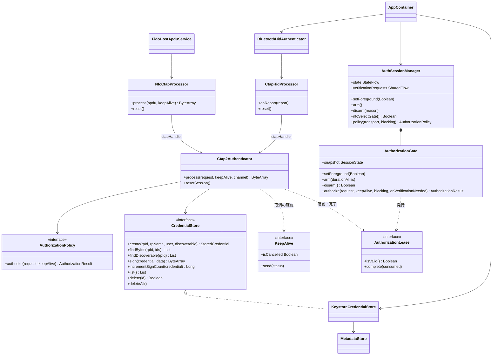
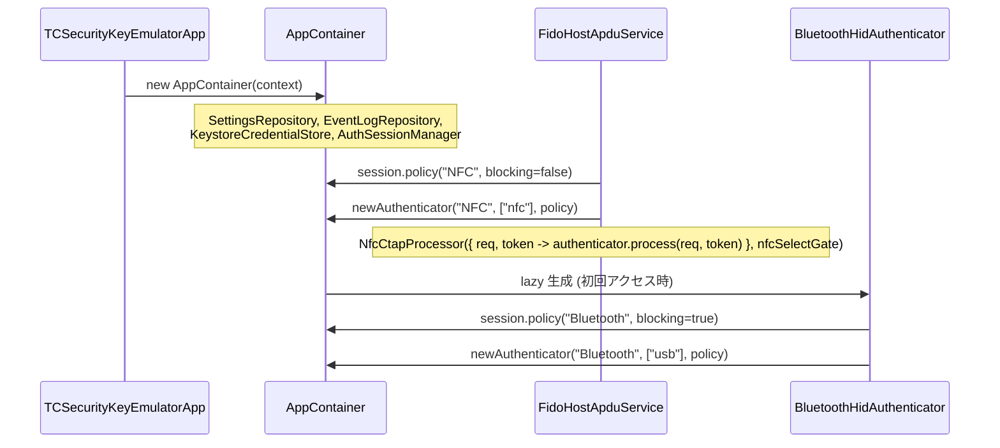

# DD-04 モジュール・クラス設計

| 項目 | 内容 |
|---|---|
| 文書番号 | TCSKE-DD-04 |
| 版数 | 1.1 |
| 作成日 | 2026-11-02 |
| 改訂 | 1.1 (2026-11-02): 外部レビュー対応 (`AuthorizationGate`・`AuthorizationLease` の追加、`TransportPolicy`・`onOperationCompleted`・`deleteDiscoverable` の廃止ほか)。`review/FIX_PLAN.md` |
| 関連文書 | BD-03 アーキテクチャ |

パッケージは `net.tecogonaz.tcandroidkey` を基点とする (以下では省略)。

## 1. クラス図

## 2. fido-core

### 2.1 `fido.cbor`

| クラス / 関数 | 責務 |
|---|---|
| `Cbor.encode(value)` | Kotlin 値 (Int/Long/ByteArray/String/List/Map/Boolean/null/Double) を canonical CBOR に変換 |
| `Cbor.decode(data, offset, length)` | 1 データ項目をデコード (末尾余剰・非最短表現・タグ・不正 UTF-8 はエラー。DD-01 §1.2) |
| `Cbor.decodeFirst(data, offset)` | 先頭 1 項目をデコードし消費バイト数を返す (authenticatorData 内の COSE_Key 解析用) |
| `CborException` | CBOR の不正 |
| `Map<*,*>.int/bytes/text/map/list/bool/has` | 整数キー (`Int` → `Long` 正規化) によるマップアクセス |

### 2.2 `fido.ctap2`

| クラス | 責務 |
|---|---|
| `Ctap2Authenticator` | CTAP2 コマンド処理 (DD-01)。1 トランスポートに 1 インスタンス (GetNextAssertion 状態を保持)。`process` は `@Synchronized`、`resetSession` はブロックしない (`@Volatile`)。時計は wall clock (イベント) と単調時計 (GetNextAssertion) を注入できる |
| `CredentialStore` | 鍵保管の抽象 (スレッドセーフであること) |
| `StoredCredential` | クレデンシャルのメタデータ (DD-06 §2)。秘密鍵は含まない。等価性は全フィールドの内容 (StateFlow の更新を抑止しないため)。同一性は `isSameCredential`。並び順 `NEWEST_FIRST` (作成日時の新しい順、同時刻は ID 順) |
| `UserEntity` | `id` / `name` / `displayName` |
| `KeySecurityLevel` | `STRONGBOX` / `TEE` / `SOFTWARE` / `UNKNOWN` |
| `AuthorizationPolicy` / `AuthorizationRequest` / `AuthorizationResult` | 認可の抽象 (DD-01 §1.4) |
| `AuthorizationLease` | 許可した操作の有効性 (`isValid`) と終了 (`complete(consumed)`)。`UNBOUND` は管理しないポリシー用 (DD-05 §2.4) |
| `KeepAlive` | 要求ごとの keepalive 送信 (`STATUS_PROCESSING` = 1、`STATUS_UP_NEEDED` = 2) と取消トークン (`isCancelled`) |
| `AuthenticatorConfig` | AAGUID、アテステーション方式、transports、リセット許可、maxMsgSize。`configProvider` で要求毎に取得 (設定変更を即時反映) |
| `AuthenticatorEvent` / `AuthenticatorEventListener` | 処理結果の通知 |
| `CtapCommand` / `CtapStatus` / `CoseAlgorithm` / `AuthDataFlags` | 定数・名前変換 |
| `CtapException(status)` | CTAP エラーの伝搬 |
| `KeyUseNotAuthorizedException` | 鍵の使用不可 (認証期限切れ・無効化)。`0x27` に変換 |
| `Hex` / `EcKeys` | 16 進変換、EC 公開鍵の座標取得・COSE_Key 生成 |

### 2.3 `fido.nfc`

| クラス | 責務 |
|---|---|
| `NfcCtapProcessor(ctapHandler, selectGate, maxCommandSize = 8192, versionString = "FIDO_2_0")` | APDU 処理 (DD-02)。状態 (選択済み・チェイン・未送信応答) を持ち `@Synchronized`。`ctapHandler(request, keepAlive)` |
| `Apdu` (internal) | 短い APDU / 拡張長 APDU の解析 |

### 2.4 `fido.hid`

| クラス | 責務 |
|---|---|
| `CtapHidProcessor(ctapHandler, sendReport, worker)` | CTAPHID のフレーミング (DD-03)。受信は `lock`、送信は `sendLock` で排他。CBOR 要求ごとの操作 (取消トークン) を作り `worker` で実行。`ctapHandler(cid, request, keepAlive)` |

### 2.5 `fido.session`

| クラス | 責務 |
|---|---|
| `AuthorizationGate(elapsed, wallClock, oneTime, waitTimeoutMillis, listener)` | 前面・受付・ワンタイム予約・世代 (epoch) を 1 ロックで管理し、全トランスポートで共有する認可判定 (DD-05 §2)。Android 非依存で JVM の単体テスト対象 |
| `SessionState` | `foreground`、`armedUntilElapsed`、`armedDurationMillis`、`lastAuthenticationAtMillis`、`lastAuthenticationRpId`。`isArmed(now)`、`remainingMillis(now)` |
| `AuthorizationGate.Listener` | 状態変化 (`onStateChanged`) とワンタイム消費 (`onConsumed`) の通知 |

## 3. app

### 3.1 ルート

| クラス | 責務 |
|---|---|
| `TCSecurityKeyEmulatorApp` | Application。`AppContainer` を生成 |
| `AppContainer` | 手動 DI。`SettingsRepository`、`EventLogRepository`、`KeystoreCredentialStore`、`AuthSessionManager`、`BluetoothHidAuthenticator` (遅延生成)、AAGUID 定数、`newAuthenticator(transport, transports, policy)` |
| `Context.appContainer` | コンテナ取得の拡張プロパティ |
| `MainActivity` | 唯一の Activity。ライフサイクル連携 (BD-03 §4.4)、`UiActions` の実装、本人確認要求の購読、`FLAG_SECURE`、Bluetooth 権限要求 |

### 3.2 `auth`

| クラス | 責務 |
|---|---|
| `AuthSessionManager` | `AuthorizationGate` を包む層。Android の時計・設定・ログとの橋渡し、`StateFlow<AuthSessionState>`、NFC 選択ゲート、本人確認要求の発行、トランスポート別の `AuthorizationPolicy` の生成 (`blocking` = false: NFC / true: Bluetooth) (DD-05 §2) |
| `AuthSessionState` | fido-core の `SessionState` の別名 (typealias) |
| `VerificationRequest` | 本人確認要求 (要求元トランスポート、RP ID) |
| `UserVerifier` | BiometricPrompt のラッパー。`availability(biometricOnly)`、`verify(title, subtitle, biometricOnly, negativeLabel, onResult)`、`cancel()` |
| `VerificationAvailability` | `AVAILABLE` / `NO_SECURE_LOCK_SCREEN` / `NO_STRONG_BIOMETRIC` / `UNAVAILABLE` |

### 3.3 `keystore`

| クラス | 責務 |
|---|---|
| `KeystoreCredentialStore` | `CredentialStore` の Android Keystore 実装 (DD-07)。保存済みと一致する不変スナップショット + `StateFlow<List<StoredCredential>>` (UI 用)、`StateFlow<StorageStatus>` (読み込み状態)。読み込み時に鍵が存在しないメタデータを除去。読み込めない場合は UNAVAILABLE (DD-07 §5) |
| `MetadataStore` (internal) | メタデータの暗号化保存 (DD-06 §3) |

### 3.4 `nfc` / `bluetooth`

| クラス | 責務 |
|---|---|
| `FidoHostApduService` | HCE サービス (DD-02 §6) |
| `BluetoothHidAuthenticator` | HID Device 登録・状態管理 (DD-03 §4)。`State(status, hostName, message)`、`Status` = `UNSUPPORTED` / `PERMISSION_REQUIRED` / `BLUETOOTH_OFF` / `STOPPED` / `STARTING` / `WAITING_FOR_HOST` / `CONNECTED` / `ERROR` |

### 3.5 `data` / `domain`

| クラス | 責務 |
|---|---|
| `SettingsRepository` | SharedPreferences (`settings`) の読み書き、`StateFlow<AppSettings>`。受付時間が選択肢外の更新は無視 |
| `AppSettings` / `AppTheme` | 設定値 (DD-06 §4)。`KEYSTORE_AUTH_VALIDITY_SECONDS` = 300 |
| `EventLogRepository` | メモリ内ログ (最大 300 件、新しい順)、`onAuthenticatorEvent` による CTAP イベントの整形、logcat 出力 (RP ID・ユーザー名を除く。DD-09 §3) |
| `DeviceCapabilities` | NFC 有無・有効、HCE、StrongBox、画面ロック、Bluetooth の有無 |

### 3.6 `ui`

| クラス | 責務 |
|---|---|
| `MainViewModel` | 各リポジトリの `StateFlow` (ストアの読み込み状態を含む) を公開、削除・初期化・設定変更・Bluetooth 開始停止、スナックバーメッセージ |
| `AppRoot` | ドロワー/常設サイドバー、TopAppBar、NavHost、`Routes` |
| `UiActions` | Activity が提供する操作 (本人確認して開始、本人確認後に実行、各種設定画面、Bluetooth 権限、検出可能化、URL) |
| `authenticator.AuthenticatorScreen` | SC-01 |
| `credentials.CredentialsScreen` | SC-02 |
| `log.EventLogScreen` / `LogEntryRow` | SC-03 |
| `settings.SettingsScreen` | SC-04 |
| `about.AboutScreen` | SC-05 |
| `document.DocumentScreen` / `document.LegalDocument` | SC-06。文書の定義 (assets のパス、リポジトリのパス)、文書内リンクの解決 |
| `common.*` | 流用部品 (BD-06 §4。`MarkdownParser` を含む)、`TestUseNoticeDialog`、`formatDateTime` / `formatTime` |
| `theme.TCSecurityKeyEmulatorTheme` | テーマ |

## 4. 主要な依存関係の生成

