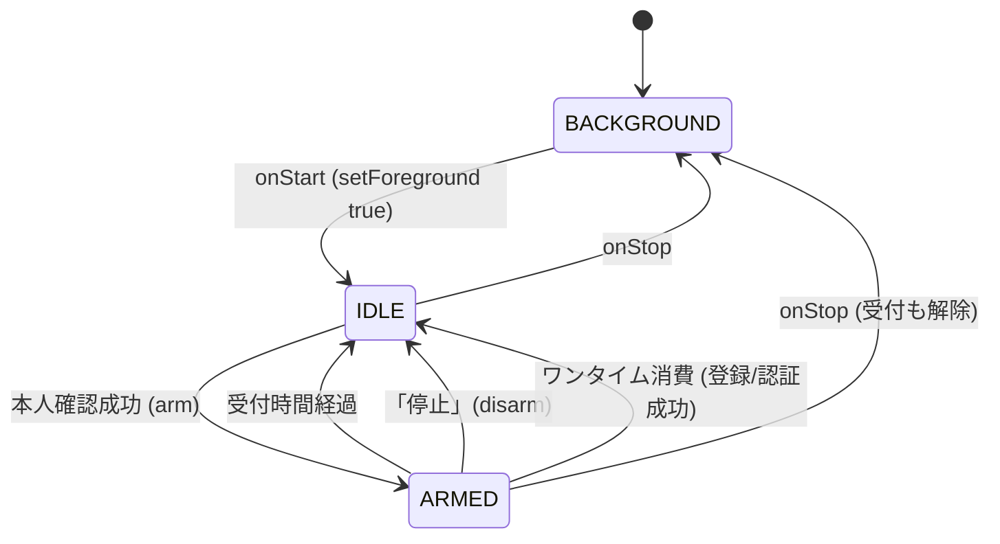
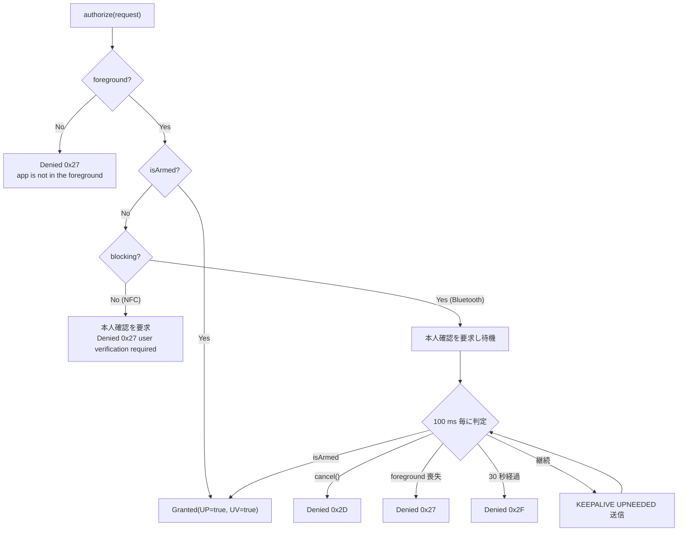
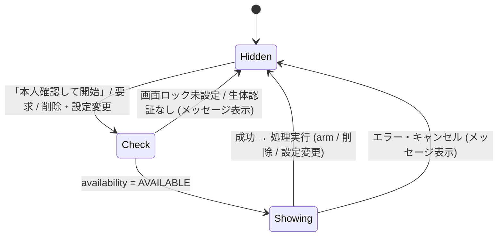
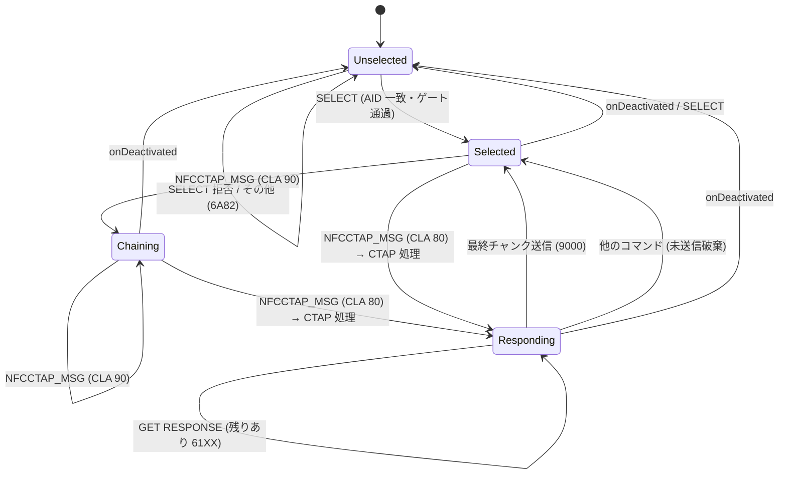
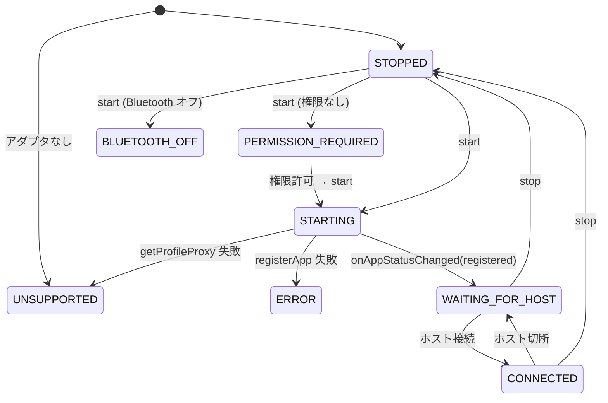

# DD-05 状態遷移

| 項目 | 内容 |
|---|---|
| 文書番号 | TCAK-DD-05 |
| 版数 | 1.0 |
| 作成日 | 2026-11-02 |
| 実装 | `app/.../auth/AuthSessionManager.kt`, `MainActivity.kt`, `bluetooth/BluetoothHidAuthenticator.kt`, `fido-core/.../nfc/NfcCtapProcessor.kt` |
| 関連要件 | FR-11〜FR-15, SEC-02, SEC-04 |

## 1. 時刻の基準

受付期限は `SystemClock.elapsedRealtime()` (起動からの経過時間、端末の時刻変更の影響を受けない) で管理する。
最終使用日時など表示用の時刻は `System.currentTimeMillis()` を用いる。

## 2. 認証受付セッション

### 2.1 状態

`AuthSessionState` の `foreground` と `armedUntilElapsed` の組み合わせで決まる。

| 状態 | foreground | armedUntilElapsed | 認証 |
|---|---|---|---|
| 非表示 (BACKGROUND) | false | null | 拒否 |
| 待機 (IDLE) | true | null または期限切れ | 拒否 (本人確認を要求) |
| 受付中 (ARMED) | true | 現在時刻より後 | 許可 |

### 2.2 遷移の詳細

| 操作 | 処理 |
|---|---|
| `setForeground(true)` | `foreground = true` (受付期限は保持する。画面ロック資格情報による本人確認では一時的に別画面が前面になるため) |
| `setForeground(false)` | `foreground = false`、`armedUntilElapsed = null`、待機中のブロッキング認可を起こす |
| `arm()` | `armedUntilElapsed = 現在 + 受付時間`、`armedDurationMillis = 受付時間`。ログ "verified: accepting authentication for Ns" |
| `disarm(reason)` | `armedUntilElapsed = null`。受付中だった場合ログ "authorization ended: …" |
| 完了通知 (成功・UP あり・Selection 以外) | `lastAuthenticationAtMillis` / `lastAuthenticationRpId` を更新。ワンタイム ON なら `disarm("one-time authorization used")` |

> 受付時間の経過は時刻比較 (`isArmed(now)`) で判定し、タイマーは使わない。画面のカウントダウンは 250 ms 毎に再描画する。

### 2.3 認可判定 (TransportPolicy.authorize)

- 本人確認要求 (`requestVerification`) は、前面表示中かつ設定「確認前にかざしたら確認画面を表示」が ON の場合のみ発行する。
- Activity は要求を受けたとき、本人確認ダイアログを表示中でなく、受付中でもない場合に限りダイアログを表示する。

## 3. 本人確認ダイアログ

| 設定 | 許可する認証手段 | キャンセルボタン |
|---|---|---|
| 生体認証のみ OFF (既定) | `BIOMETRIC_STRONG` + `DEVICE_CREDENTIAL` | なし (OS の UI) |
| 生体認証のみ ON | `BIOMETRIC_STRONG` | あり |

`UserVerifier` は表示中の二重表示を防ぐ (`isShowing`)。

## 4. NFC セッション (NfcCtapProcessor)

## 5. Bluetooth HID

