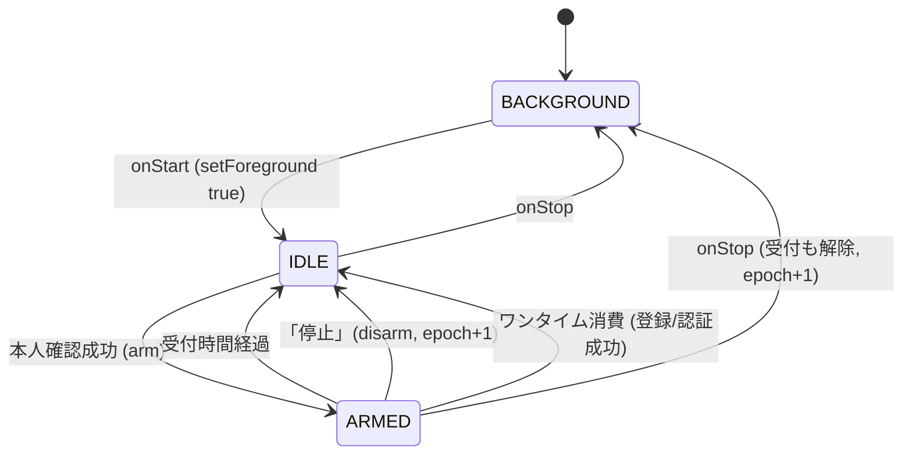
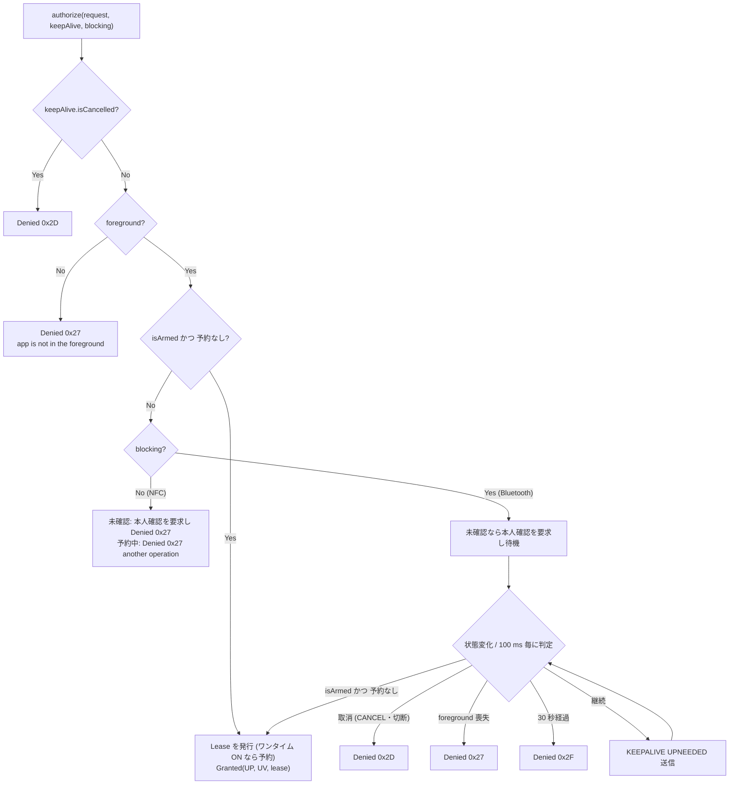
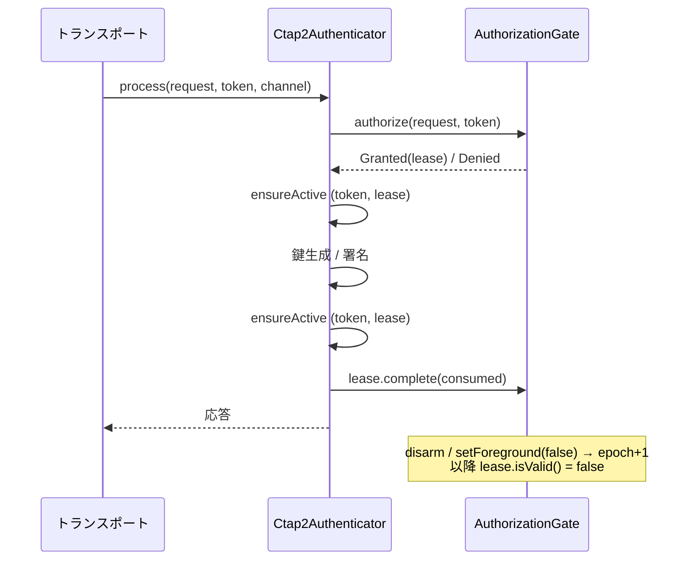
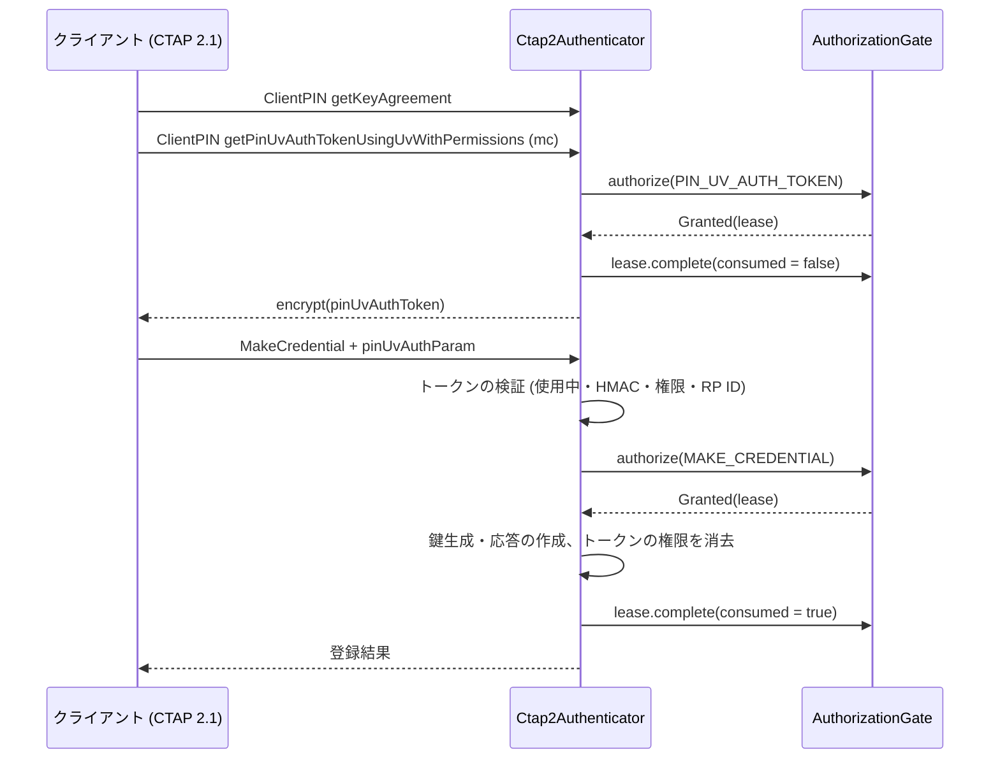
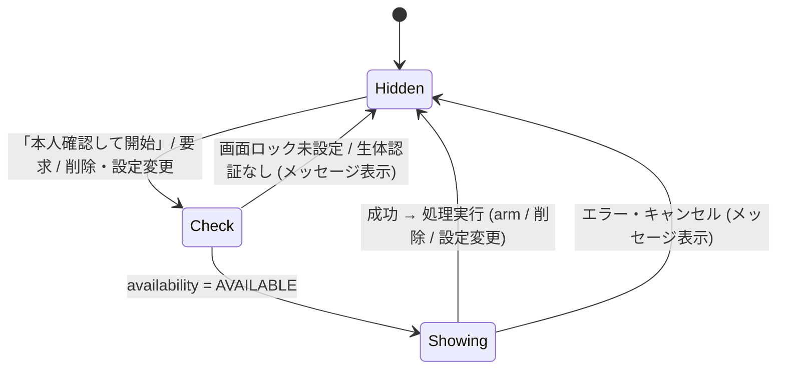
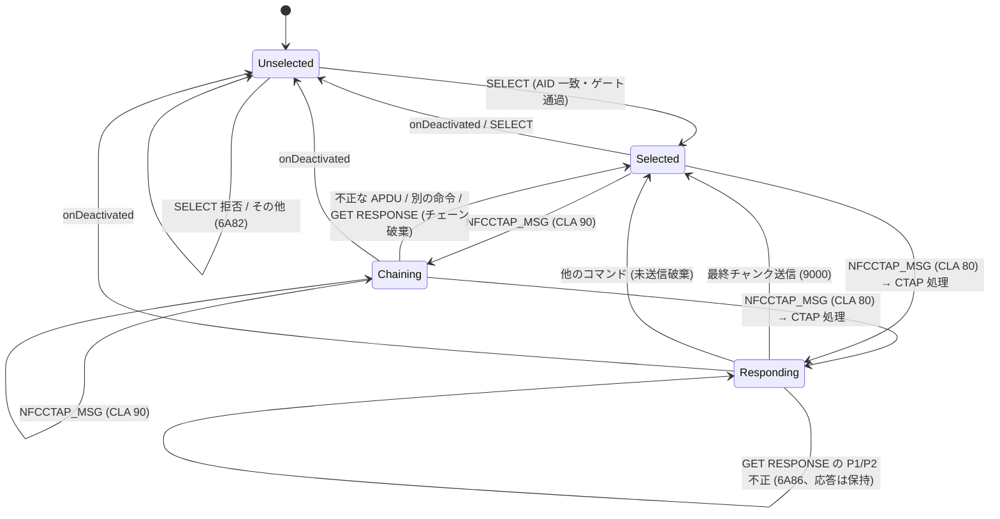
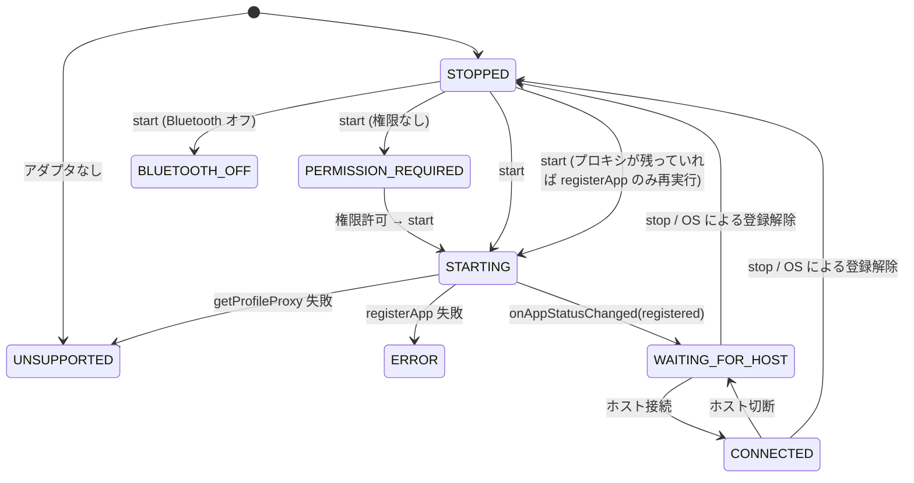

# DD-05 状態遷移

| 項目 | 内容 |
|---|---|
| 文書番号 | TCSKE-DD-05 |
| 版数 | 1.2 |
| 作成日 | 2026-11-02 |
| 改訂 | 1.2 (2026-11-05): §2.5 pinUvAuthToken と受付ゲートの関係を追加 |
| 改訂 | 1.1 (2026-11-02): 外部レビュー対応。認可を全トランスポート共有の `AuthorizationGate` に集約し、Lease・取消トークン・接続世代を導入 (`review/FIX_PLAN.md`) |
| 実装 | `fido-core/.../session/AuthorizationGate.kt`, `app/.../auth/AuthSessionManager.kt`, `MainActivity.kt`, `bluetooth/BluetoothHidAuthenticator.kt`, `fido-core/.../nfc/NfcCtapProcessor.kt`, `app/.../nfc/FidoHostApduService.kt` |
| 関連要件 | FR-11〜FR-15, FR-22, SEC-02, SEC-04 |

## 1. 時刻の基準

受付期限は `SystemClock.elapsedRealtime()` (起動からの経過時間、端末の時刻変更の影響を受けない) で管理する。
最終使用日時など表示用の時刻は `System.currentTimeMillis()` を用いる。
GetNextAssertion のタイマーも単調時計 (`System.nanoTime()` 基準) で計る (DD-01 §5)。

## 2. 認証受付セッション

受付状態・ワンタイムの予約・失効は、全トランスポート (NFC / Bluetooth) で共有する `AuthorizationGate` (fido-core、
Android 非依存) が 1 つのロックで管理する。`AuthSessionManager` は Android の時計・設定・ログ・UI への確認要求との
橋渡しをする薄い層である。

### 2.1 状態

`SessionState` (`AuthSessionState` はその別名) の `foreground` と `armedUntilElapsed` の組み合わせで決まる。
内部状態として、世代 `epoch`、受付番号 `armId`、ワンタイムの予約 `reservation` を持つ。

| 状態 | foreground | armedUntilElapsed | 認証 |
|---|---|---|---|
| 非表示 (BACKGROUND) | false | null | 拒否 |
| 待機 (IDLE) | true | null または期限切れ | 拒否 (本人確認を要求) |
| 受付中 (ARMED) | true | 現在時刻より後 | 許可 (ワンタイム ON で予約中の場合は拒否 / 待機) |

### 2.2 遷移の詳細

| 操作 | 処理 |
|---|---|
| `setForeground(true)` | `foreground = true` (受付期限は保持する。画面ロック資格情報による本人確認では一時的に別画面が前面になるため) |
| `setForeground(false)` | `foreground = false`、`armedUntilElapsed = null`、**`epoch` を進め予約を解放** (発行済み Lease はすべて失効)、待機中のブロッキング認可を起こす |
| `arm(duration)` | `armId` を進め、`armedUntilElapsed = 現在 + 受付時間`。ログ "verified: accepting authentication for Ns" |
| `disarm()` (明示的な停止) | `armedUntilElapsed = null`、**`epoch` を進め予約を解放**。受付中だった場合ログ "authorization ended: …" |
| `Lease.complete(consumed = true)` | 予約を解放し、`lastAuthenticationAtMillis` / `RpId` を更新。ワンタイム ON かつ **Lease の `armId` が現在の受付と一致する場合のみ** 受付を終了する (`epoch` は進めない) |
| `Lease.complete(consumed = false)` | 予約を解放するだけ (受付は継続) |

> 受付時間の経過は時刻比較 (`isArmed(now)`) で判定し、タイマーは使わない。画面のカウントダウンは 250 ms 毎に再描画する。

### 2.3 認可判定 (AuthorizationGate.authorize)

- 判定と予約は同じロック内で行う。NFC と Bluetooth から同時に要求されても、ワンタイム ON では 1 つの操作にしか許可しない。
  ワンタイム OFF では予約しない (同時処理を許可する)。
- 本人確認要求 (`requestVerification`) は、前面表示中かつ設定「確認前にかざしたら確認画面を表示」が ON の場合のみ発行する。
  予約中 (他の操作の実行中) を理由に拒否する場合は要求しない。
- Activity は要求を受けたとき、本人確認ダイアログを表示中でなく、受付中でもない場合に限りダイアログを表示する。

### 2.4 操作の寿命 (Lease・取消トークン)

許可した 1 つの操作 (MakeCredential、GetAssertion とそれに続く GetNextAssertion 群、Reset、Selection) は
`AuthorizationLease` で管理する。トランスポートは要求ごとに取消トークン (`KeepAlive.isCancelled`) を作って渡す。

| 項目 | 内容 |
|---|---|
| `Lease.isValid()` | `foreground` かつ発行時の `epoch` が現在と一致。明示的な停止・前面離脱で false。ワンタイムの消費では false にならない |
| 有効性の確認箇所 | 鍵の生成の直前、署名の直前、応答を返す直前 (`Ctap2Authenticator.ensureActive`) |
| 失効時の動作 | `CTAP2_ERR_OPERATION_DENIED` を返す。生成済みで応答していない credential は削除する |
| 取消トークン | NFC: 受信時の接続世代 (DD-02 §6)。Bluetooth: CBOR 要求ごとの操作 (DD-03 §2.4)。取消時は `CTAP2_ERR_KEEPALIVE_CANCEL` |
| 完了 | すべての経路 (成功・失敗・excludeList 該当・PIN プローブ・NO_CREDENTIALS・例外) で `complete` を 1 回呼ぶ |
| 継続 (GetNextAssertion) | 元の GetAssertion の Lease・取消トークン・チャネル (CID) がすべて有効な場合のみ実行する |

### 2.5 pinUvAuthToken と受付ゲート

CTAP 2.1 の pinUvAuthToken (DD-01 §12.1) は、受付ゲートの認可を置き換えない。トークンの発行・トークンを使う操作のどちらでも
`AuthorizationGate.authorize` を呼ぶ。

| 操作 | 認可 | ワンタイム |
|---|---|---|
| トークンの発行 (ClientPIN 0x06) | `PIN_UV_AUTH_TOKEN` (UV 要)。受付外なら NFC は拒否、Bluetooth は本人確認を待つ | 消費しない (`complete(false)`) |
| トークンを使う登録・UP を伴う認証 | `MAKE_CREDENTIAL` / `GET_ASSERTION` | 消費する |
| トークンを使う silent assertion | `GET_ASSERTION` (UP なし) | 消費しない |
| 資格情報の管理 (CredentialManagement 0x0A) | `CREDENTIAL_MANAGEMENT`。列挙の続きは開始時の Lease で継続 | 消費しない |

トークンは発行時の Lease を保持し、`Lease.isValid()` が false になる (停止・前面離脱) と使えなくなる。
NFC の切断などで `Ctap2Authenticator.resetSession` が呼ばれた場合も使えなくなる (セッションの世代)。

## 3. 本人確認ダイアログ

| 設定 | 許可する認証手段 | キャンセルボタン |
|---|---|---|
| 生体認証のみ OFF (既定) | `BIOMETRIC_STRONG` + `DEVICE_CREDENTIAL` | なし (OS の UI) |
| 生体認証のみ ON | `BIOMETRIC_STRONG` | あり |

`UserVerifier` は表示中の二重表示を防ぐ (`isShowing`)。

## 4. NFC セッション (NfcCtapProcessor)

拡張長 APDU の要求には、応答全体を拡張長の応答として一度に返すため、Responding を経由しない
(Le が明示的に応答より短い場合を除く。DD-02 §3.2)。

## 5. Bluetooth HID

- プロキシの有無 (`hid`) と登録状態 (`registered`) は別に管理する。OS がバックグラウンド化などで登録を解除した場合、
  次の `start()` (アプリが前面に戻ったとき) で登録し直す。
- `stop()` の後に遅れて届いたプロキシ接続 (`onServiceConnected`) は、登録せずに閉じる (`desiredStarted`)。
- `stop()` は UI スレッドから呼ばれる。先に取消 (`CtapHidProcessor.reset()`) を行い、CTAP 処理のロックは待たない。
