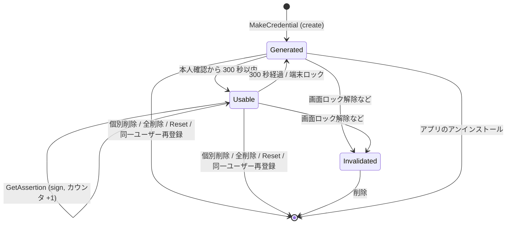

# DD-07 鍵管理

| 項目 | 内容 |
|---|---|
| 文書番号 | TCSKE-DD-07 |
| 版数 | 1.4 |
| 作成日 | 2026-11-02 |
| 改訂 | 1.4 (2026-11-05): PIN の暗号鍵と保存 (§1、§5、§7) を追加 |
| 改訂 | 1.3 (2026-11-05): クライアントからの削除 (credentialManagement) を §5 に追加 |
| 改訂 | 1.2 (2026-11-05): hmac-secret の HMAC 鍵 (§1、§4.1、§5、§6) を追加 |
| 改訂 | 1.1 (2026-11-02): 外部レビュー対応 (保存成功後の反映、上書き登録の順序、読み込めない場合の初期化)。`review/FIX_PLAN.md` |
| 実装 | `app/.../keystore/KeystoreCredentialStore.kt`, `MetadataStore.kt` |
| 関連要件 | NFR-04, FR-08, FR-09, FR-21, FR-25, FR-26, SEC-01〜SEC-03 |

## 1. 鍵の種類

| 鍵 | アルゴリズム | 用途 | ユーザー認証 |
|---|---|---|---|
| クレデンシャル鍵 | EC P-256 (secp256r1) / SHA-256 | WebAuthn 署名・自己アテステーション | 必要 (§2) |
| hmac-secret の HMAC 鍵 | HMAC-SHA256 | CredRandom の導出 (§6) | 必要 (§2 と同じ) |
| メタデータ暗号鍵 | AES-256 / GCM | メタデータの暗号化 | 不要 |
| PIN の暗号鍵 | AES-256 / GCM | PIN (ハッシュと試行回数) の暗号化 (§7) | 不要 |

## 2. クレデンシャル鍵の生成パラメータ

```kotlin
KeyGenParameterSpec.Builder(alias, KeyProperties.PURPOSE_SIGN)
    .setAlgorithmParameterSpec(ECGenParameterSpec("secp256r1"))
    .setDigests(KeyProperties.DIGEST_SHA256)
    .setUserAuthenticationRequired(true)
    .setUserAuthenticationParameters(300, AUTH_BIOMETRIC_STRONG or AUTH_DEVICE_CREDENTIAL)
    .setUnlockedDeviceRequired(true)
    .setIsStrongBoxBacked(strongBox)
```

| 属性 | 目的 |
|---|---|
| `setUserAuthenticationRequired` + `setUserAuthenticationParameters(300, …)` | 直近 300 秒以内に Class 3 生体認証または画面ロック資格情報で認証された場合のみ署名可能 (SEC-02 の多重防御) |
| `setUnlockedDeviceRequired(true)` | 端末ロック中は使用不可 (SEC-03) |
| `setIsStrongBoxBacked` | 設定「StrongBox を優先」ON かつ `FEATURE_STRONGBOX_KEYSTORE` ありの場合に true |

- アプリ側の受付時間 (最大 300 秒) は Keystore の認証有効期間 (300 秒) 以下とする。
- BiometricPrompt の成功 (CryptoObject なし) で Keystore に認証トークンが渡り、時間制限付き鍵が使用可能になる。
- 鍵は非エクスポート (Android Keystore の仕様)。

## 3. ライフサイクル



## 4. 処理

### 4.1 生成 (`create`)

| # | 処理 |
|---|---|
| 1 | `SecureRandom` で 32 バイトのクレデンシャル ID を生成し、エイリアス `fido_cred_<hex>` を決める |
| 2 | StrongBox 指定で鍵を生成。`StrongBoxUnavailableException` なら TEE で再生成 |
| 3 | 生成に失敗した場合 (画面ロック未設定など) は `CtapException(0x27 OPERATION_DENIED)` |
| 4 | `KeyInfo.securityLevel` から保管レベル (STRONGBOX / TEE / SOFTWARE / UNKNOWN) を取得 |
| 4a | `hmac-secret` を要求された場合は HMAC 鍵 (エイリアス `fido_hmac_<hex>`) を同じ StrongBox の扱いで生成する。失敗した場合は生成した鍵をすべて削除して `CtapException(0x27)` |
| 5 | 公開鍵座標を取り出してメタデータを作成し、新しいスナップショットをファイルに保存してからキャッシュに反映する |
| 6 | 保存に失敗した場合は、生成した鍵 (HMAC 鍵を含む) を削除して `CtapException(0x7F)` (メタデータのない鍵を残さない) |

### 4.2 署名 (`sign`)

| # | 処理 | 例外の変換 |
|---|---|---|
| 1 | Keystore から秘密鍵を取得 | なし → `CtapException(0x22 INVALID_CREDENTIAL)` |
| 2 | `Signature("SHA256withECDSA").initSign` | `UserNotAuthenticatedException` / `KeyPermanentlyInvalidatedException` / その他 `InvalidKeyException` → `KeyUseNotAuthorizedException` |
| 3 | `update(data)`、`sign()` (DER 形式) | 失敗 → `KeyUseNotAuthorizedException` |

`KeyUseNotAuthorizedException` は `Ctap2Authenticator` で `0x27 OPERATION_DENIED` に変換する。
登録で応答を返さなかった場合 (自己アテステーションの失敗、認可の失効など) は、作成した鍵を削除する (DD-01 §3.2)。

### 4.3 署名カウンタ (`incrementSignCount`)

署名の直前に +1 してメタデータに保存し、`lastUsedAtMillis` を更新する。保存に失敗した場合は署名しない。

## 5. 削除

| 操作 | 処理 | 本人確認 |
|---|---|---|
| 個別削除 (FR-08) | メタデータから除いたスナップショットを保存してから `KeyStore.deleteEntry(alias)` (HMAC 鍵も削除)。鍵の削除に失敗した場合の残骸は全削除で除去される | 必要 (SC-02 → DL-02 → DL-01) |
| 全削除 (FR-09) | `fido_cred_`・`fido_hmac_` で始まる全エイリアスを削除、PIN も消去 (§7)、メタデータファイルとメタデータの暗号鍵を削除、キャッシュ消去 | 必要 |
| 初期化 (読み込めない場合) | 全削除と同じ (画面 SC-02 の「初期化 (すべて削除)」) | 必要 |
| OS からのリセット (FR-10) | 全削除と同じ (PIN も消す) | 設定で許可 (変更時に本人確認) + 認可 |
| クライアントからの削除 (FR-24) | credentialManagement の deleteCredential。個別削除と同じ処理 | cm 権限の pinUvAuthToken (内蔵 UV = 本人確認で発行) + 認可 (DD-01 §12.4) |
| PIN の消去 (FR-26) | `pin.bin` と PIN の暗号鍵を削除する。クレデンシャルは残す | 必要 (SC-04 → DL-01) |
| 同一ユーザー再登録 | 新しい credential の完成後に、それ以前に作成された同一ユーザーの discoverable credential を個別削除 | 登録の認可に含む |

削除処理は画面操作の場合 `Dispatchers.IO` で実行し、失敗はイベントログに記録する。

### 5.1 メタデータを読み込めない場合

| 項目 | 内容 |
|---|---|
| 状態 | `StorageStatus(UNAVAILABLE, error)` |
| 拒否する操作 | 登録・認証・個別削除 (`0x7F`)。既存のファイルを空や一部の内容で上書きしない |
| 再試行 | 次の操作のたびに読み込みを再試行する (一時的な失敗なら自動で回復する) |
| 利用者の操作 | SC-02 に案内と「初期化 (すべて削除)」を表示する。初期化はメタデータの暗号鍵も作り直す |

## 6. hmac-secret の CredRandom

CTAP の hmac-secret は credential ごとに 2 つの CredRandom (UV あり用・UV なし用、各 32 バイト) を求める (DD-01 §11.2)。
本アプリは CredRandom そのものを保存せず、credential ごとの Keystore の HMAC 鍵 K から導出する。

```kotlin
KeyGenParameterSpec.Builder("fido_hmac_<hex>", KeyProperties.PURPOSE_SIGN)   // KEY_ALGORITHM_HMAC_SHA256
    .setUserAuthenticationRequired(true)
    .setUserAuthenticationParameters(300, AUTH_BIOMETRIC_STRONG or AUTH_DEVICE_CREDENTIAL)
    .setUnlockedDeviceRequired(true)
    .setIsStrongBoxBacked(strongBox)
```

| 値 | 導出 |
|---|---|
| CredRandomWithUV | `HMAC-SHA256(K, "CredRandomWithUV")` |
| CredRandomWithoutUV | `HMAC-SHA256(K, "CredRandomWithoutUV")` |

- K は Keystore の外に出ない。導出した CredRandom は出力の計算の間だけアプリのメモリ上にある (BD-05 R-08)。
- 外部から観測できるのは `HMAC(CredRandom, salt)` だけであり、導出方法の違いは相互運用性に影響しない。
- `Mac.init` の例外 (`UserNotAuthenticatedException` 等) は署名と同じく `KeyUseNotAuthorizedException` (`0x27`) に変換する。
- HMAC 鍵がない credential (`hmacSecret` = false、または鍵が失われた場合) は CredRandom なし (null) として拡張を無視する。

## 7. PIN の保存 (KeystorePinStore)

| 項目 | 内容 |
|---|---|
| 保存内容 | `LEFT(SHA-256(PIN), 16)` と残りの試行回数 (DD-06 §3.4)。PIN そのものは保存しない |
| 暗号鍵 | Keystore の AES-256-GCM 鍵 `tcsecuritykeyemulator_pin_v1`。ユーザー認証は不要 (PIN の照合は受付ゲートの認可の後に行うため、鍵の使用条件で二重に制限しない) |
| 照合 | 試行回数を 1 減らして保存してから比較する。保存できなければ例外 (`0x7F`) とし、比較しない |
| 反映 | 保存に成功してから、メモリ上の状態と UI 用の `StateFlow<PinStatus>` を更新する |
| 読み込めない場合 | UNAVAILABLE。PIN の操作を拒否し、ファイルを上書きしない。次の操作で再試行する |
| 消去 | ファイルと暗号鍵を削除する (次回の保存で鍵を作り直す)。Reset・アプリの全削除・SC-04 の「PIN を消去」 |

