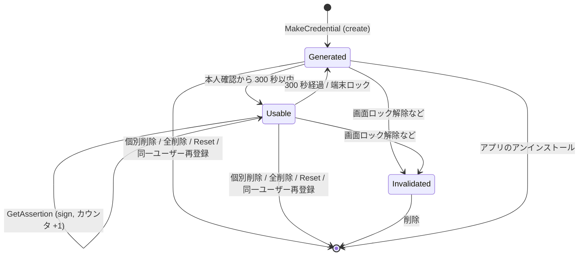

# DD-07 鍵管理

| 項目 | 内容 |
|---|---|
| 文書番号 | TCAK-DD-07 |
| 版数 | 1.0 |
| 作成日 | 2026-11-02 |
| 実装 | `app/.../keystore/KeystoreCredentialStore.kt`, `MetadataStore.kt` |
| 関連要件 | NFR-04, FR-08, FR-09, SEC-01〜SEC-03 |

## 1. 鍵の種類

| 鍵 | アルゴリズム | 用途 | ユーザー認証 |
|---|---|---|---|
| クレデンシャル鍵 | EC P-256 (secp256r1) / SHA-256 | WebAuthn 署名・自己アテステーション | 必要 (§2) |
| メタデータ暗号鍵 | AES-256 / GCM | メタデータの暗号化 | 不要 |

## 2. クレデンシャル鍵の生成パラメータ

```kotlin
KeyGenParameterSpec.Builder(alias, KeyProperties.PURPOSE_SIGN)
    .setAlgorithmParameterSpec(ECGenParameterSpec("secp256r1"))
    .setDigests(KeyProperties.DIGEST_SHA256)
    .setUserAuthenticationRequired(true)
    .setUserAuthenticationParameters(300, AUTH_BIOMETRIC_STRONG or AUTH_DEVICE_CREDENTIAL)
    .setUnlockedDeviceRequired(true)
    .setIsStrongBoxBacked(strongBox)
```

| 属性 | 目的 |
|---|---|
| `setUserAuthenticationRequired` + `setUserAuthenticationParameters(300, …)` | 直近 300 秒以内に Class 3 生体認証または画面ロック資格情報で認証された場合のみ署名可能 (SEC-02 の多重防御) |
| `setUnlockedDeviceRequired(true)` | 端末ロック中は使用不可 (SEC-03) |
| `setIsStrongBoxBacked` | 設定「StrongBox を優先」ON かつ `FEATURE_STRONGBOX_KEYSTORE` ありの場合に true |

- アプリ側の受付時間 (最大 300 秒) は Keystore の認証有効期間 (300 秒) 以下とする。
- BiometricPrompt の成功 (CryptoObject なし) で Keystore に認証トークンが渡り、時間制限付き鍵が使用可能になる。
- 鍵は非エクスポート (Android Keystore の仕様)。

## 3. ライフサイクル



## 4. 処理

### 4.1 生成 (`create`)

| # | 処理 |
|---|---|
| 1 | `SecureRandom` で 32 バイトのクレデンシャル ID を生成し、エイリアス `fido_cred_<hex>` を決める |
| 2 | StrongBox 指定で鍵を生成。`StrongBoxUnavailableException` なら TEE で再生成 |
| 3 | 生成に失敗した場合 (画面ロック未設定など) は `CtapException(0x27 OPERATION_DENIED)` |
| 4 | `KeyInfo.securityLevel` から保管レベル (STRONGBOX / TEE / SOFTWARE / UNKNOWN) を取得 |
| 5 | 公開鍵座標を取り出してメタデータを作成し、キャッシュとファイルに保存 |

### 4.2 署名 (`sign`)

| # | 処理 | 例外の変換 |
|---|---|---|
| 1 | Keystore から秘密鍵を取得 | なし → `CtapException(0x22 INVALID_CREDENTIAL)` |
| 2 | `Signature("SHA256withECDSA").initSign` | `UserNotAuthenticatedException` / `KeyPermanentlyInvalidatedException` / その他 `InvalidKeyException` → `KeyUseNotAuthorizedException` |
| 3 | `update(data)`、`sign()` (DER 形式) | 失敗 → `KeyUseNotAuthorizedException` |

`KeyUseNotAuthorizedException` は `Ctap2Authenticator` で `0x27 OPERATION_DENIED` に変換する。
登録時の自己アテステーションで発生した場合は、作成した鍵を削除する。

### 4.3 署名カウンタ (`incrementSignCount`)

署名の直前に +1 してメタデータに保存し、`lastUsedAtMillis` を更新する。

## 5. 削除

| 操作 | 処理 | 本人確認 |
|---|---|---|
| 個別削除 (FR-08) | `KeyStore.deleteEntry(alias)`、キャッシュから除去、ファイル保存 | 必要 (SC-02 → DL-02 → DL-01) |
| 全削除 (FR-09) | `fido_cred_` で始まる全エイリアスを削除、キャッシュ消去、メタデータファイル削除 | 必要 |
| OS からのリセット (FR-10) | 全削除と同じ | 設定で許可 (変更時に本人確認) + 認可 |
| 同一ユーザー再登録 | 該当の discoverable credential を個別削除 | 登録の認可に含む |

削除処理は画面操作の場合 `Dispatchers.IO` で実行する。
